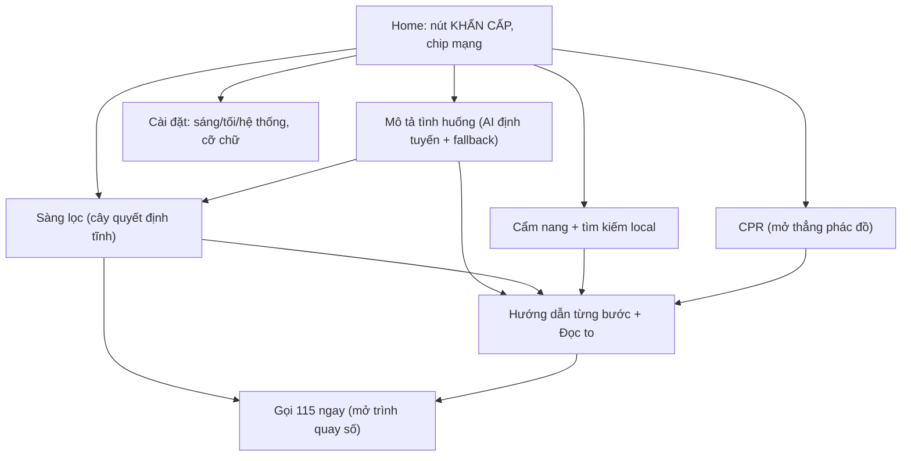
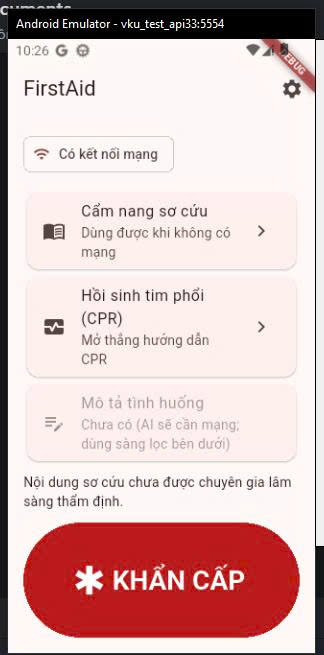
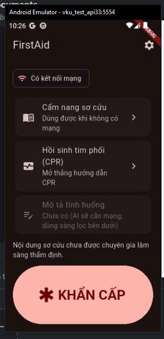
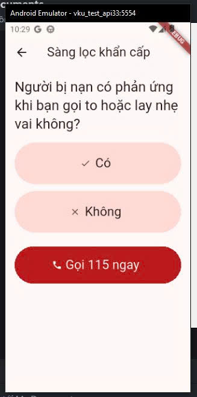
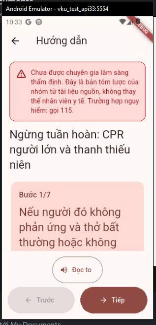

> Báo cáo bổ sung muộn, nộp gộp theo hướng dẫn của giảng viên; nội dung phản ánh trạng thái thực tế tại thời điểm viết.

# [REPORT 1] PROJECT PROPOSAL & INTERACTIVE WIREFRAME PROTOTYPE
**Course:** Cross-Platform Mobile App Development  
**Project Title:** FirstAid – Ứng dụng trợ lý sơ cứu khẩn cấp ngoại tuyến và kết nối hỗ trợ cộng đồng / Offline-First Emergency First Aid Assistant & Community Support App  
**Team Name:** [CHƯA CÓ BẰNG CHỨNG: tên nhóm do người dùng cung cấp] • **Academic Term:** Semester 1 (2026 - 2027) • **Deadline:** Week 4

---

## 1. PROJECT MOTIVATION & PROBLEM STATEMENT
### 1.1. Context & Practical Problem Space
Nguồn: docs/source/description/FirstAid_Mo_ta_de_tai_hieu_chinh_Capstone.docx (mục 1-2).
Trong tình huống sơ cứu khẩn cấp, người chứng kiến có thể hoảng loạn, quên trình tự, khó đánh giá thông tin trên Internet, gặp mẹo truyền miệng nguy hiểm hoặc không có mạng ổn định để tra cứu.

### 1.2. Target User Personas
* **Primary Persona:** Người dân, sinh viên, người đi đường, gia đình, người làm việc ngoài hiện trường, tình nguyện viên (theo mô tả đề tài). [CHƯA CÓ BẰNG CHỨNG: persona chi tiết (tuổi, nghề nghiệp, pain points) chưa được nhóm viết.]
* **Typical User Story:** Mở nhanh chế độ khẩn cấp (không cần đăng nhập) → trả lời câu hỏi sàng lọc ngắn → xem các bước có đọc to → gọi 115 / soạn SMS kèm vị trí để người dùng xác nhận.

---

## 2. SYSTEM SCOPE & FUNCTIONAL SPECIFICATIONS
| # | Feature Category | Concrete Feature | Priority | Business Logic & Scope |
|:---:|---|---|:---:|---|
| 1 | Core | Chế độ khẩn cấp một chạm | Must-Have | Không cần tài khoản; câu hỏi sàng lọc theo luồng quyết định đã kiểm duyệt. |
| 2 | Offline | Cẩm nang sơ cứu offline | Must-Have | Drift/SQLite; TTS đọc từng bước; hiển thị nguồn và phiên bản. |
| 3 | Location | SOS và vị trí | Must-Have | Gọi 115; lấy tọa độ khi được cấp quyền; mở SMS soạn sẵn, không gửi âm thầm. |
| 4 | AI | AI hỗ trợ tìm đúng hướng dẫn | Must-Have | Streaming LLM + RAG qua FastAPI; chỉ định tuyến tới phác đồ có sẵn; offline dùng luồng quyết định tĩnh. |
| 5 | Core | Bộ đếm nhịp CPR | Should-Have | Metronome 100-120 nhịp/phút; không tuyên bố đo độ sâu ép tim. |
| 6 | Extension | Bản đồ điểm hỗ trợ; cộng đồng tình nguyện viên | Could-Have | Mở rộng, chưa cam kết ở MVP. |

### Luồng người dùng và màn hình đã triển khai (đã chạy trên emulator Android; chưa chạy trên điện thoại thật)
Cài đặt trong `app/lib/presentation/`. **Figma chỉ là prototype định hướng luồng màn hình; giao diện cuối cùng là app Flutter đã chạy** (ảnh chụp bên dưới và trong R4 là từ emulator `vku_test_api33`, Android 13). Giao diện thực tế có thể khác prototype Figma.

| Màn hình | Nội dung chính | Trạng thái |
|---|---|---|
| Home | Nút KHẨN CẤP lớn (icon + chữ), chip mạng (icon + chữ), lối vào cẩm nang/CPR/Mô tả tình huống/cài đặt | Có test widget; đã chạy trên emulator (ảnh bên dưới) |
| Mô tả tình huống | Nhập mô tả; từ khóa nguy cấp kiểm tra trên máy → Gọi 115; AI chỉ chọn mã phác đồ có sẵn; mọi lỗi/mất mạng/chưa cấu hình AI → fallback sàng lọc offline (chi tiết R3 mục 1b) | Có test widget/unit; đã chạy thủ công với backend local trên emulator (E-031); bản release hiện offline-only (R-33) |
| SOS | Gọi 115, vị trí, SMS soạn sẵn có xác nhận (mô tả ngay dưới bảng) | Có test widget; chưa kiểm chứng trên điện thoại thật |
| Sàng lọc | Câu hỏi Có/Không lần lượt; nút "Gọi 115 ngay" ở mọi bước | Có test widget |
| Hướng dẫn từng bước | Một hành động mỗi bước, Đọc to (vi-VN), KHÔNG ĐƯỢC LÀM, nguồn + phiên bản + cảnh báo chưa thẩm định | Có test widget; TTS thật chưa kiểm chứng trên máy |
| Cẩm nang | Danh sách + tìm kiếm local không dấu | Có test widget |
| Cài đặt | Sáng/Tối/Hệ thống, cỡ chữ, lưu qua SharedPreferences | Có test widget; chưa kiểm chứng lưu qua khởi động lại trên máy |

Luồng SOS (Prompt 04): Home hoặc màn sàng lọc → "SOS: gửi vị trí" → màn giải thích quyền vị trí → lấy vị trí (hoặc bỏ qua) → xem trước vị trí và nội dung tin nhắn, ghi chú tùy chọn → "Xác nhận và mở tin nhắn" (mở ứng dụng SMS với nội dung soạn sẵn, người dùng tự bấm Gửi). Xử lý: từ chối quyền, từ chối vĩnh viễn (mở cài đặt ứng dụng), GPS tắt (mở cài đặt vị trí), hết thời gian chờ; luôn có "Gọi 115 ngay". Không bắt đăng nhập.

### Giới hạn của SOS (cần nêu khi trình bày)
- Tọa độ GPS lấy được khi không có Internet (cần máy thu nhìn thấy tín hiệu GPS; trong nhà hoặc lần định vị đầu có thể chậm hoặc hết thời gian chờ).
- Tile bản đồ và địa chỉ chữ cần Internet: app KHÔNG hiển thị bản đồ hay địa chỉ chữ. Liên kết bản đồ trong nội dung tin nhắn chỉ mở được khi người nhận có Internet; tọa độ số vẫn đọc được.
- Gọi 115 và nhắn tin cần sóng di động (SIM còn sóng). "Mất Internet" không đồng nghĩa "mất sóng": có thể gọi/nhắn được dù không có Internet, và ngược lại.
- App không tự gửi tin nhắn (không xin quyền SEND_SMS): chỉ mở ứng dụng tin nhắn với nội dung soạn sẵn, người nhận để trống, người dùng tự chọn và tự bấm Gửi.
- Chưa có nguồn xác nhận 115 nhận SMS nên không mặc định gửi tin tới 115; nút "Gọi 115 ngay" chỉ mở trình quay số.
- Chưa kiểm chứng trên điện thoại thật.

### Trạng thái các tính năng đã đề xuất (cập nhật 2026-11-12)
| # | Tính năng đề xuất | Trạng thái hiện tại | Bằng chứng |
|:---:|---|---|---|
| 1 | Chế độ khẩn cấp một chạm | Đã triển khai (sàng lọc Có/Không, hướng dẫn từng bước, Gọi 115) | E-009, E-028 |
| 2 | Cẩm nang sơ cứu offline | Đã triển khai: 6 phác đồ từ IFRC-2025, nội dung chưa được chuyên gia thẩm định | E-006, E-007 |
| 3 | SOS và vị trí | Đã triển khai trong app; chưa thử trên điện thoại thật | E-011 |
| 4 | AI hỗ trợ tìm đúng hướng dẫn | Đã triển khai backend + app; backend chưa deploy; bản release hiện offline-only | E-017..E-022, E-031, R-33 |
| 5 | Bộ đếm nhịp CPR (Should-Have) | **Chưa triển khai** (chỉ là mục Future Work) | — |
| 6 | Bản đồ điểm hỗ trợ, cộng đồng tình nguyện viên (Could-Have) | **Chưa triển khai** (Future Work) | — |

### Ảnh chụp từ emulator Android 13 (`vku_test_api33`, bản debug, ngày 2026-11-06 và 2026-11-07)
Ảnh chụp trên emulator, không phải điện thoại thật. Home trong hai ảnh đầu chụp trước khi có tính năng AI (thẻ "Mô tả tình huống" còn bị tắt); bản hiện tại xem ảnh release trong R4 mục 5.3.

| Home giao diện Sáng | Home giao diện Tối |
|---|---|
|  |  |

| Sàng lọc | Hướng dẫn từng bước (CPR) |
|---|---|
|  |  |

Lưu ý: tên file `triage-01-consciousness-dark.png` chứa chữ "dark" nhưng ảnh hiển thị giao diện **Sáng**; Dark Mode thật chỉ thấy ở ảnh Home Tối. Video SOS trên điện thoại thật: [CHỜ NGƯỜI DÙNG QUAY MÀN HÌNH]. Ảnh chụp sáng/tối trên điện thoại thật (docs/evidence/screenshots/emergency_ui.md): [CHỜ NGƯỜI DÙNG CHỤP].

---

## 3. TECH STACK & INITIAL ARCHITECTURE
* **Framework:** Flutter 3.x (Dart 3) • **State Management:** Riverpod 2
* **Backend:** Supabase (BaaS) + FastAPI (AI orchestration) • **Local DB:** Drift (SQLite) • **AI Engine:** Streaming LLM API (Gemini) + RAG-lite
* **🔗 Figma Prototype URL:** https://www.figma.com/design/jOBAMpW4SDwM9r6R3aKDg3/FirstAid-%E2%80%93-Mobile-App-Prototype?node-id=0-1&t=MaVpZ0hz9emCILPi-1  
  Người dùng cho biết đã đặt chia sẻ công khai ("Anyone with the link can view"); báo cáo này chưa kiểm chứng bằng cách mở link ở cửa sổ ẩn danh. Số luồng trong file Figma chưa được đối chiếu trong báo cáo. Figma là prototype định hướng luồng; giao diện cuối là app đã chạy.
