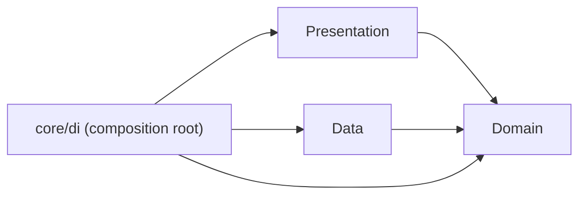
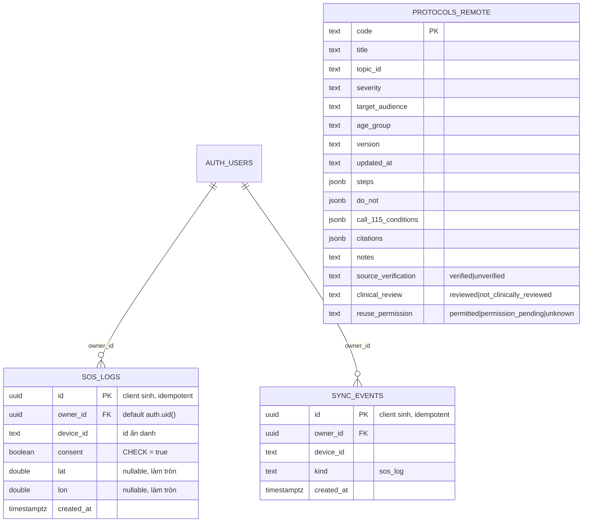

> Báo cáo bổ sung muộn, nộp gộp theo hướng dẫn của giảng viên; nội dung phản ánh trạng thái thực tế tại thời điểm viết.

# [REPORT 2] DETAILED ARCHITECTURE & CORE FEATURE IMPLEMENTATION
**Course:** Cross-Platform Mobile App Development  
**Project Title:** FirstAid  
**Team Name:** [CHƯA CÓ BẰNG CHỨNG: tên nhóm] • **Academic Term:** Semester 1 (2026 - 2027) • **Deadline:** Week 8

---

## 1. CLEAN ARCHITECTURE IMPLEMENTATION
* **Presentation Layer:** `app/lib/presentation/{screens,widgets,providers,theme,router}` — Material 3, go_router, màn Home rỗng với nút SOS (icon + chữ). Riverpod wiring ở `app/lib/core/di/providers.dart`.
* **Domain Layer:** `app/lib/domain/{entities,repositories,usecases}` — Dart thuần. Entity: FirstAidProtocol, ProtocolStep, TriageNode, EmergencyCase, SosMessage (+ 3 enum trạng thái nguồn). Use case: GetOfflineProtocols, GetProtocolByCode, StartEmergencyFlow, PrepareSosMessage.
* **Data Layer:** Drift/SQLite local datasource (`app/lib/data/datasources/local/`), seed loader từ asset JSON, parser `data/models/seed_parser.dart`, `DriftProtocolRepository`, `DriftEmergencyRepository`. [CHƯA CÓ BẰNG CHỨNG: Supabase datasource chưa triển khai.]

### Sơ đồ phụ thuộc

Domain không import Presentation/Data/Flutter/Drift/Supabase/http/Riverpod; được kiểm bằng `app/test/architecture/domain_isolation_test.dart`.

### Cây thư mục (từ lệnh `find lib test -type f`, 2026-11-05)
```
lib/core/di/providers.dart
lib/core/utils/.gitkeep
lib/data/datasources/{local,remote}/.gitkeep
lib/data/models/.gitkeep
lib/data/repositories/in_memory_{emergency,protocol}_repository.dart
lib/domain/entities/{emergency_case,first_aid_protocol,protocol_step,sos_message,source_status,triage_node}.dart
lib/domain/repositories/{emergency,protocol}_repository.dart
lib/domain/usecases/{get_offline_protocols,get_protocol_by_code,prepare_sos_message,start_emergency_flow}.dart
lib/main.dart
lib/presentation/{providers/.gitkeep,router/app_router.dart,screens/home_screen.dart,theme/app_theme.dart,widgets/sos_button.dart}
test/architecture/domain_isolation_test.dart
test/widget_test.dart
```
Log kiểm tra: `docs/evidence/tests/skeleton-checks-20261105-224643.log` (pub get, format, analyze, test đều exit=0; 3 test pass).

### Dữ liệu phác đồ và lưu trữ cục bộ (Prompt 02)
- Nguồn nội dung: IFRC-2025 (`verified` trong `docs/source/medical/source_register.csv`); bản tóm lược/dịch tiếng Việt do nhóm thực hiện, `clinical_review = not_clinically_reviewed`. Nguồn Việt Nam (VN-MOH-636-2025, VN-BYT-MOET-TNTT-2022) CHƯA đối chiếu vì PDF không trích được text.
- Asset: `app/assets/protocols/protocols_v1.json` (6 phác đồ: bleeding_wounds_severe, burns_thermal_chemical, choking_adult_child, choking_baby, cpr_adult_adolescent, cpr_baby_child) và `app/assets/triage/triage_v1.json` (cây quyết định tĩnh, không phải AI).
- Drift schema v1: bảng `protocols`, `protocol_steps`, `triage_nodes`, `meta`. Seed ở lần chạy đầu và khi `data_version` đổi (hiện `1.0.0+1.0.0`). Dữ liệu y tế chỉ đọc với UI.
- UI hiển thị nguồn (source_id + trang), phiên bản và cảnh báo khi `clinical_review != reviewed`.
- Log kiểm tra: `docs/evidence/tests/drift-seed-checks-20261106-010345.log` (format, analyze "No issues found", 17 test pass; mọi lệnh exit=0).

### Dịch vụ nền tảng và cài đặt (Prompt 03)
- Domain khai báo interface `TtsService`, `ConnectivityService`, `DialerService`, `SettingsRepository` (`app/lib/domain/services`, `domain/repositories`); Data hiện thực bằng flutter_tts, connectivity_plus, url_launcher, shared_preferences (`app/lib/data/services`, `data/repositories/shared_prefs_settings_repository.dart`). Nhờ đó UI test thay bằng fake.
- Use case mới: `AdvanceTriage`, `SearchProtocols` (tìm kiếm local, bỏ dấu tiếng Việt).
- Không màn hình nào gọi API để mở phác đồ: dữ liệu đọc từ Drift.
- Log kiểm tra: `docs/evidence/tests/emergency-ui-checks-20261106-013932.log` (format, analyze "No issues found", 28 test pass; mọi lệnh exit=0).

### SOS: vị trí và SMS có xác nhận (Prompt 04)
- Domain: `PrepareSosMessage` (tọa độ tùy chọn + ghi chú + thời gian truyền vào; ghi chú cắt ở 160 ký tự), interface `LocationService`, `SmsComposer`, use case `GetCurrentLocationForSos`.
- Data: `GeolocatorLocationService` (geolocator, giới hạn thời gian 15 giây), `UrlLauncherSmsComposer` (URI `sms:` dùng %20, người nhận để trống). Presentation: `SosScreen` (giải thích → lấy vị trí → xem trước → xác nhận).
- AndroidManifest: chỉ `ACCESS_FINE_LOCATION` + `ACCESS_COARSE_LOCATION` (không background location, không SEND_SMS); `<queries>` cho `SENDTO sms`.
- Log kiểm tra: `docs/evidence/tests/sos-checks-20261107-214838.log` (format, analyze "No issues found", 45 test pass; mọi lệnh exit=0); build APK debug thành công: `docs/evidence/tests/build-apk-debug-20261107-215148.log` (chưa chạy trên máy).

### Giới hạn của SOS (cần nêu khi trình bày)
- Tọa độ GPS lấy được khi không có Internet (cần máy thu nhìn thấy tín hiệu GPS; trong nhà hoặc lần định vị đầu có thể chậm hoặc hết thời gian chờ).
- Tile bản đồ và địa chỉ chữ cần Internet: app KHÔNG hiển thị bản đồ hay địa chỉ chữ. Liên kết bản đồ trong nội dung tin nhắn chỉ mở được khi người nhận có Internet; tọa độ số vẫn đọc được.
- Gọi 115 và nhắn tin cần sóng di động (SIM còn sóng). "Mất Internet" không đồng nghĩa "mất sóng": có thể gọi/nhắn được dù không có Internet, và ngược lại.
- App không tự gửi tin nhắn (không xin quyền SEND_SMS): chỉ mở ứng dụng tin nhắn với nội dung soạn sẵn, người nhận để trống, người dùng tự chọn và tự bấm Gửi.
- Chưa có nguồn xác nhận 115 nhận SMS nên không mặc định gửi tin tới 115; nút "Gọi 115 ngay" chỉ mở trình quay số.
- Chưa kiểm chứng trên điện thoại thật.

### Supabase và hàng đợi đồng bộ (Prompt 05)
- Domain (Dart thuần): `RemoteSyncSource`, `SyncQueueRepository`, `ProtocolSyncStore` (interface); use case `SyncProtocols`, `ProcessSyncQueue`, `EnqueueSosLog`, `RunSync`; entity `SyncJob`.
- Data: `SupabaseRemoteSyncSource` (supabase_flutter), `DriftSyncQueueRepository` (bảng `sync_jobs`, Drift schema v2 có `onUpgrade` từ v1), `DriftProtocolSyncStore` (ghi trong một transaction).
- Cấu hình qua `--dart-define-from-file=.env` (`AppConfig`); thiếu URL/key thì không khởi tạo Supabase, sync tắt, app dùng dữ liệu local.
- Log kiểm tra: `docs/evidence/tests/sync-checks-20261107-234308.log` (format, analyze "No issues found", 63 test pass; mọi lệnh exit=0). Build APK debug: `docs/evidence/tests/build-apk-debug-20261107-234503.log` (exit=0, chưa chạy trên máy). Chưa có kiểm thử với Supabase thật.
- `EnqueueSosLog` mới là use case + test; CHƯA nối vào UI SOS và CHƯA có màn đăng nhập/consent, nên hiện app chưa gửi log SOS nào.

---

## 2. DATABASE SCHEMA & SECURITY POLICIES
Nguồn: `supabase/migrations/0001_init.sql`. TRẠNG THÁI: file đã viết, **CHƯA chạy lên Supabase thật** (người dùng sẽ tự chạy sau khi duyệt).

### ERD (từ migration)

Không lưu ghi chú tự do, số điện thoại hay số liên hệ trong `sos_logs`.

### Chính sách RLS (RLS bật ở cả 3 bảng)
| Bảng | Vai trò | SELECT | INSERT | UPDATE/DELETE |
|---|---|---|---|---|
| protocols_remote | anon, authenticated | Có (mọi dòng) | Không có policy | Không có policy |
| sos_logs | anon | Không (không GRANT) | Không | Không |
| sos_logs | authenticated | Chỉ dòng `owner_id = auth.uid()` | Chỉ khi `owner_id = auth.uid()` và `consent = true` | Không (append-only) |
| sync_events | anon | Không | Không | Không |
| sync_events | authenticated | Chỉ dòng của mình | Chỉ khi `owner_id = auth.uid()` | Không |

Ghi `protocols_remote` chỉ qua dashboard/service role (bỏ qua RLS). Phòng thủ lớp hai: `REVOKE ALL` rồi `GRANT` tối thiểu. Đăng nhập là tùy chọn và KHÔNG chặn SOS: gửi log lên server cần phiên đăng nhập + consent; chưa có màn đăng nhập trong app.

### Đã kiểm chứng / chưa kiểm chứng
- Đã: unit test hàng đợi, chính sách xung đột, migration Drift (xem mục 1, Prompt 05).
- CHƯA: policy RLS chưa chạy trên Supabase. Kịch bản test ở `supabase/tests/rls_test.sql` (anon, người A, người B); kết quả [CHỜ NGƯỜI DÙNG CHẠY] → `docs/evidence/rls/`. Chưa có bằng chứng RLS hoạt động.

---

## 3. CORE FEATURE IMPLEMENTATION PROGRESS
* **🔗 GitHub Tag / Branch M2:** [CHƯA CÓ BẰNG CHỨNG: chưa có tag/branch]
* **🎥 Milestone 2 Video Demo (2–3 minutes):** [CHƯA CÓ BẰNG CHỨNG: chưa có video]
