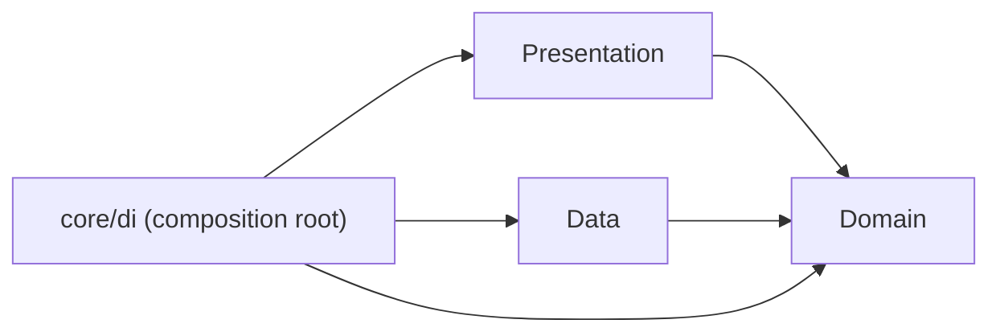

> Báo cáo bổ sung muộn, nộp gộp theo hướng dẫn của giảng viên; nội dung phản ánh trạng thái thực tế tại thời điểm viết.

# [REPORT 2] DETAILED ARCHITECTURE & CORE FEATURE IMPLEMENTATION
**Course:** Cross-Platform Mobile App Development  
**Project Title:** FirstAid  
**Team Name:** [CHƯA CÓ BẰNG CHỨNG: tên nhóm] • **Academic Term:** Semester 1 (2026 - 2027) • **Deadline:** Week 8

---

## 1. CLEAN ARCHITECTURE IMPLEMENTATION
* **Presentation Layer:** `app/lib/presentation/{screens,widgets,providers,theme,router}` — Material 3, go_router, màn Home rỗng với nút SOS (icon + chữ). Riverpod wiring ở `app/lib/core/di/providers.dart`.
* **Domain Layer:** `app/lib/domain/{entities,repositories,usecases}` — Dart thuần. Entity: FirstAidProtocol, ProtocolStep, TriageNode, EmergencyCase, SosMessage (+ 3 enum trạng thái nguồn). Use case: GetOfflineProtocols, GetProtocolByCode, StartEmergencyFlow, PrepareSosMessage.
* **Data Layer:** `app/lib/data/repositories` hiện chỉ có stub in-memory (không chứa nội dung y khoa). [CHƯA CÓ BẰNG CHỨNG: Drift/SQLite, Supabase datasource chưa triển khai.]

### Sơ đồ phụ thuộc

Domain không import Presentation/Data/Flutter/Drift/Supabase/http/Riverpod; được kiểm bằng `app/test/architecture/domain_isolation_test.dart`.

### Cây thư mục (từ lệnh `find lib test -type f`, 2026-11-05)
```
lib/core/di/providers.dart
lib/core/utils/.gitkeep
lib/data/datasources/{local,remote}/.gitkeep
lib/data/models/.gitkeep
lib/data/repositories/in_memory_{emergency,protocol}_repository.dart
lib/domain/entities/{emergency_case,first_aid_protocol,protocol_step,sos_message,source_status,triage_node}.dart
lib/domain/repositories/{emergency,protocol}_repository.dart
lib/domain/usecases/{get_offline_protocols,get_protocol_by_code,prepare_sos_message,start_emergency_flow}.dart
lib/main.dart
lib/presentation/{providers/.gitkeep,router/app_router.dart,screens/home_screen.dart,theme/app_theme.dart,widgets/sos_button.dart}
test/architecture/domain_isolation_test.dart
test/widget_test.dart
```
Log kiểm tra: `docs/evidence/tests/skeleton-checks-20261105-224643.log` (pub get, format, analyze, test đều exit=0; 3 test pass).

---

## 2. DATABASE SCHEMA & SECURITY POLICIES
* [CHƯA CÓ BẰNG CHỨNG: ERD chưa được tạo.]
* [CHƯA CÓ BẰNG CHỨNG: chính sách RLS chưa được viết/kiểm thử.]

---

## 3. CORE FEATURE IMPLEMENTATION PROGRESS
* **🔗 GitHub Tag / Branch M2:** [CHƯA CÓ BẰNG CHỨNG: chưa có tag/branch]
* **🎥 Milestone 2 Video Demo (2–3 minutes):** [CHƯA CÓ BẰNG CHỨNG: chưa có video]
