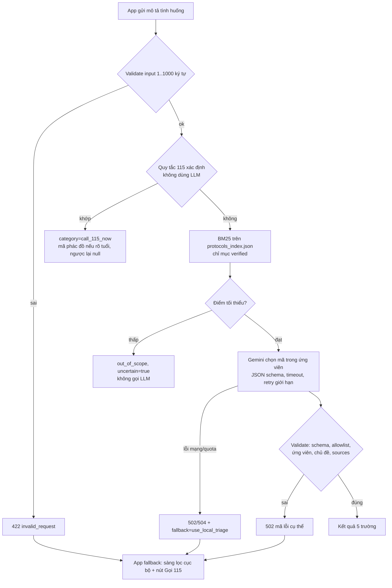

> Báo cáo bổ sung muộn, nộp gộp theo hướng dẫn của giảng viên; nội dung phản ánh trạng thái thực tế tại thời điểm viết.

# [REPORT 3] AI INTEGRATION, OFFLINE SYNC & TEST REPORT
**Course:** Cross-Platform Mobile App Development  
**Project Title:** FirstAid  
**Team Name:** [CHƯA CÓ BẰNG CHỨNG: tên nhóm] • **Academic Term:** Semester 1 (2026 - 2027) • **Deadline:** Week 11

---

## 1. ARTIFICIAL INTELLIGENCE CAPABILITIES & BENCHMARKS
* **Model Backbone:** Gemini qua SDK `google-genai` 2.33.0 (tên model cấu hình qua `GEMINI_MODEL`; mặc định `gemini-2.5-flash` CHƯA được xác minh bằng API). Dịch vụ FastAPI `backend/` + RAG-lite (BM25). Đã chạy eval với Gemini thật 2 lượt (2026-11-08, xem bên dưới). [CHƯA CÓ BẰNG CHỨNG: chưa deploy; app Flutter chưa tích hợp (Prompt 07).]
* **Vai trò của AI:** chỉ chọn một mã phác đồ trong số ứng viên truy xuất được (hoặc `null`). Không chẩn đoán, không kê thuốc, không sinh hướng dẫn sơ cứu; nội dung sơ cứu luôn lấy từ phác đồ cục bộ có trích dẫn. Hỗ trợ SSE: sự kiện trạng thái, mảnh đầu ra tạm (chưa validate) và kết quả cuối đã validate.

### Pipeline

### Số đo đã có (chỉ từ lệnh đã chạy; nhãn do nhóm tự gán và cần người dùng rà lại)
Nguồn: bộ 35 ca `backend/eval/cases.jsonl`. Các số này đo hành vi trên tập nhỏ do chính nhóm viết, không phải độ chính xác tổng quát; quy tắc, alias và nhãn do cùng nhóm tạo nên có tính vòng tròn.

| Chỉ số | Giá trị | Ghi chú | Nguồn |
|---|---|---|---|
| Unit/integration test backend (mock LLM) | 60 pass | validation, quy tắc, retrieval, retry/timeout, SSE, log không lộ nội dung | `docs/evidence/tests/backend-pytest-20261108-011903.log` |
| Quy tắc 115: recall trên ca nhãn "gọi 115" | 9/12 | 3 ca cố ý là "khoảng hở" (không có từ khóa) nên bị bỏ sót: đây là hạn chế đã biết | `docs/evidence/ai/eval-retrieval-20261108-010516.json` |
| Quy tắc 115: mã phác đồ khớp nhãn khi quy tắc kích hoạt | 9/9 | vòng tròn (nhóm viết cả quy tắc lẫn nhãn) | `docs/evidence/ai/eval-retrieval-20261108-010516.json` |
| Quy tắc 115: kích hoạt nhầm trên ca không nhãn 115 | 0/23 | | `docs/evidence/ai/eval-retrieval-20261108-010516.json` |
| Truy xuất: mã đúng nằm trong top-k (ca có nhãn, không qua quy tắc) | 12/14 | k=3, ngưỡng điểm 2.0 | `docs/evidence/ai/eval-retrieval-20261108-010516.json` |
| Truy xuất: mã đúng đứng đầu (top-1) | 9/14 | BM25 thuần, nhạy cách diễn đạt | `docs/evidence/ai/eval-retrieval-20261108-010516.json` |
| Cổng truy xuất chặn ca không nhãn (mơ hồ/ngoài phạm vi) | 4/12 | 8/12 vẫn lọt qua cổng, phải do LLM từ chối (xem mục eval LLM thật; mẫu rất nhỏ) | `docs/evidence/ai/eval-retrieval-20261108-010516.json` |
| Cổng chặn nhầm ca có nhãn | 1/14 | "Trẻ chạm vào bàn là đang nóng" (alias "bàn là" bị từ dừng "là" cắt) | `docs/evidence/ai/eval-retrieval-20261108-010516.json` |
| Mô phỏng lỗi LLM (fake) trả đúng mã lỗi và không có kết quả | 10/10 | timeout, treo, 500, 429, JSON hỏng, mã bịa, nguồn bịa, thừa trường, LLM sập nhưng rule 115 vẫn chạy, thiếu key | `docs/evidence/ai/eval-fallback-sim-20261108-010522.json` |
| Độ trễ rules+retrieval trong tiến trình (không LLM, không mạng) | p50 0.09 ms, p95 0.14 ms (n=35) | không phải độ trễ người dùng cảm nhận | `docs/evidence/ai/eval-retrieval-20261108-010516.json` |

### Eval LLM thật: lần 1 và lần 2 (gemini-2.5-flash, google-genai 2.33.0, 35 ca, nhãn tự gán)
Hai lượt cùng bộ ca (`cases_sha256` giống nhau), cùng commit `452abb3`, cùng cấu hình (top-k 3, ngưỡng 2.0, timeout 12 s, tối đa 2 lần gọi, nghỉ 1 s giữa các ca). Khác nhau: **lần 2 chạy sau khi sửa prompt** (nguồn của ứng viên viết đúng dạng JSON `{"source_id","pages"}` không có tiền tố `p`, thêm câu "chép nguyên văn") và thêm ghi `error_detail`/`raw_llm_output` vào file kết quả. Lần 1: 2026-11-08 02:02 (+07); lần 2: 02:14 (+07).

| Chỉ số | Lần 1 | Lần 2 | Ghi chú |
|---|---|---|---|
| Nguồn hợp lệ khi LLM trả mã (`llm_sources_valid_when_code_given`) | 0/3 (0%) | 5/5 (100%) | Lần 2 không còn lỗi `llm_invalid_sources` (lần 1 có 3). Mẫu rất nhỏ (n=5) và không cùng tập ca với lần 1 |
| Đúng mã trên các ca LLM/quy tắc/cổng có trả lời | 19/21 (90.5%) | 18/20 (90.0%) | Ca bị lỗi hạ tầng không được tính; tập ca trả lời của hai lượt khác nhau |
| Đúng mã trên cả 35 ca (lỗi tính là sai) | 19/35 (54.3%) | 18/35 (51.4%) | Bị kéo xuống chủ yếu bởi lỗi hạ tầng |
| `uncertain` khớp nhãn (trên ca có trả lời) | 19/21 | 18/20 | |
| Đầu ra LLM vượt schema (trên ca gọi LLM, bỏ lỗi hạ tầng) | 10/12 | 6/7 | Lần 1: 2 `llm_invalid_json`; lần 2: 1 |
| Lỗi hạ tầng → app phải fallback (`infra_failures_fallback_rate`) | 9/35 (25.7%) | **14/35 (40.0%)** | Lần 2: cả 14 ca đều `HTTP 429 (rate limited)` theo `error_detail`. Lần 1 chưa ghi chi tiết nên chưa biết mã lỗi |
| Độ trễ đường LLM p50 / p95 | 3002.9 ms / 3858.2 ms (n=7) | 2698.0 ms / 3244.1 ms (n=6) | Gồm mạng tới Gemini, đo trong tiến trình, không gồm hop HTTP tới backend |
| Ca đi qua quy tắc 115 / cổng truy xuất | 9 / 5 | 9 / 5 | Xác định, không phụ thuộc LLM |

Nguồn: `docs/evidence/ai/eval-llm-20261108-020235.json` (lần 1), `docs/evidence/ai/eval-llm-20261108-021429.json` (lần 2).

**Diễn giải và giới hạn (cần nêu khi trình bày)**
* **Nguồn hợp lệ 0/3 → 5/5:** nhất quán với giả thuyết nguyên nhân là định dạng `pXXX-YYY` trong prompt cũ không khớp trích dẫn trong chỉ mục (`288-290`). Chưa xác nhận trực tiếp vì lần 1 không lưu đầu ra thô. Lần 2 chưa có ca lỗi nguồn nào để kiểm tra. Mẫu n=5 là quá nhỏ để khẳng định tỷ lệ 100%.
* **Rate limit:** 14/35 ca (40%) lần 2 gặp HTTP 429 nên không có kết quả LLM; chỉ 6 ca còn lại đi tới đầu ra LLM. Mọi tỷ lệ LLM ở trên vì vậy rất không ổn định, và hai lượt không so sánh trực tiếp được (tập ca trả lời khác nhau). Người dùng cho biết đang dùng gói miễn phí; file kết quả chỉ ghi `HTTP 429`, không ghi gói tài khoản. Cấu hình retry hiện tại (tối đa 2 lần gọi, backoff 0,5 s) không đủ vượt 429; hướng giảm thiểu dự kiến khi deploy: retry + backoff dài hơn, tăng thời gian nghỉ giữa lời gọi, hoặc nâng hạn mức (chưa làm). Khi hết quota, app phải fallback sang sàng lọc cục bộ.
* **`llm_invalid_json` còn lại (c18, lần 2):** đầu ra thô chỉ 28 ký tự và dừng giữa chừng (`{"category": "out_of_scope", "`), phù hợp với đầu ra bị cắt. Nguyên nhân chưa xác nhận (nghi `max_output_tokens=600`); chưa sửa.
* Nhãn do nhóm tự gán và cần người dùng rà lại; số đo chỉ mô tả hành vi trên tập nhỏ này, không phải độ chính xác tổng quát.

### CHƯA ĐO
| Chỉ số | Trạng thái |
|---|---|
| Kết quả LLM cho 14 ca bị HTTP 429 ở lần 2 | CHƯA ĐO (cần chạy lại khi hết giới hạn tốc độ) |
| Time to first token (SSE) | CHƯA ĐO |
| Tỷ lệ trên mẫu đủ lớn/ổn định (mẫu LLM hiện chỉ 6–7 ca/lượt) | CHƯA ĐO |
| Fallback khi mất mạng thật hoặc timeout thật (mới thấy 429 thật; các lỗi khác chỉ mô phỏng bằng fake) | CHƯA ĐO |

* **Metric RAM/bộ nhớ model:** không áp dụng cho AI chạy trên cloud: mô hình nằm trên máy chủ của Google, app chỉ là HTTP client; bộ nhớ phía app khi gọi API chưa đo. Không mô tả AI cloud là hoạt động offline: khi mất mạng, app dùng sàng lọc cục bộ.
* **Hạn chế:** chỉ phủ 4 chủ đề; dữ liệu truy xuất lấy từ phác đồ `not_clinically_reviewed`; nội dung tình huống đi tới Gemini (bên thứ ba) khi dùng đường LLM; endpoint công khai có rủi ro lạm dụng quota; danh sách từ khóa quy tắc chưa được rà soát lâm sàng.

---

## 2. OFFLINE-FIRST SYNCHRONIZATION ENGINE
* Local persistence Drift/SQLite đã triển khai, có test tự động trên SQLite in-memory (log `docs/evidence/tests/drift-seed-checks-20261106-010345.log`). [CHƯA CÓ BẰNG CHỨNG: chưa chạy trên thiết bị thật/chế độ máy bay; xem docs/evidence/offline-manual-test.md.]

| Chức năng | Offline? | Ghi chú |
|---|---|---|
| Cẩm nang 6 phác đồ (bước, không nên làm, khi nào gọi 115, nguồn, phiên bản) | Thiết kế: có (đọc từ SQLite) | Chưa kiểm chứng trên máy thật |
| Cây quyết định triage tĩnh (dữ liệu có trong DB, chưa có màn UI) | Thiết kế: có | Luật xác định, không phải AI |
| Cảnh báo chưa thẩm định lâm sàng | Có | Hiển thị ở danh sách và chi tiết |
| AI định tuyến (LLM + RAG-lite) | Không | Cần mạng; backend đã code + test mock + 2 lượt eval với Gemini thật (nhiều ca gặp HTTP 429), chưa tích hợp app |
| SOS: gọi 115, vị trí, SMS | Chưa triển khai | Prompt 04 |
| Đồng bộ phác đồ từ Supabase | Cần mạng để cập nhật; đọc phác đồ vẫn offline | Code + test bằng fake remote; chưa thử với Supabase thật |
### Chính sách xung đột và đồng bộ (Prompt 05)
* **Phác đồ:** server version thắng, nhưng CHỈ nhận bản `clinical_review = reviewed` và `source_verification = verified`, và chỉ khi version mới hơn bản trên máy (so sánh số). Bản chưa review không bao giờ ghi đè bản ổn định.
* **Ghi local:** toàn bộ phác đồ nhận về ghi trong một transaction; lỗi giữa chừng thì rollback, giữ bản cũ. Mất mạng hoặc sync lỗi: giữ bản local, UI không đổi.
* **Seed asset:** khi asset đổi version, seed không ghi đè phác đồ đã nhận từ server có version >= asset; asset mới hơn thì asset thắng.
* **Log SOS:** append-only, chỉ gửi khi người dùng đồng ý; ID UUID do client sinh nên gửi lại không nhân đôi (trùng khóa chính coi là đã gửi).
* **Hàng đợi:** lưu bằng Drift (`sync_jobs`), retry tối đa 5 lần, backoff mũ 30 s x 2^(n-1) tối đa 1 giờ; lỗi vĩnh viễn (RLS từ chối, dữ liệu sai) chuyển `failed` ngay. Đồng bộ chạy khi khởi động nếu có kết nối và mỗi khi kết nối quay lại.
* **Đã kiểm chứng (test tự động, fake remote, SQLite in-memory):** retry/backoff, hết lần retry, lỗi vĩnh viễn, idempotency, offline -> online, lọc bản chưa review, rollback, seed không ghi đè, migration v1 -> v2 (kiểm tra thu gọn trên bảng `meta`). Log: `docs/evidence/tests/sync-checks-20261107-234308.log`.
* **CHƯA kiểm chứng:** chạy với Supabase thật, RLS thật, mạng thật trên điện thoại, kết nối "có sóng nhưng không có Internet" (connectivity chỉ cho biết có kết nối).

---

## 3. AUTOMATED TEST SUITE & PERFORMANCE PROFILING
* **Unit Test Coverage:** [CHƯA CÓ BẰNG CHỨNG: chưa chạy test] • **Frame Rate:** [CHƯA CÓ BẰNG CHỨNG: chưa đo FPS]
* **🔗 Internal Testing APK Link:** [CHƯA CÓ BẰNG CHỨNG: chưa có bản build]
