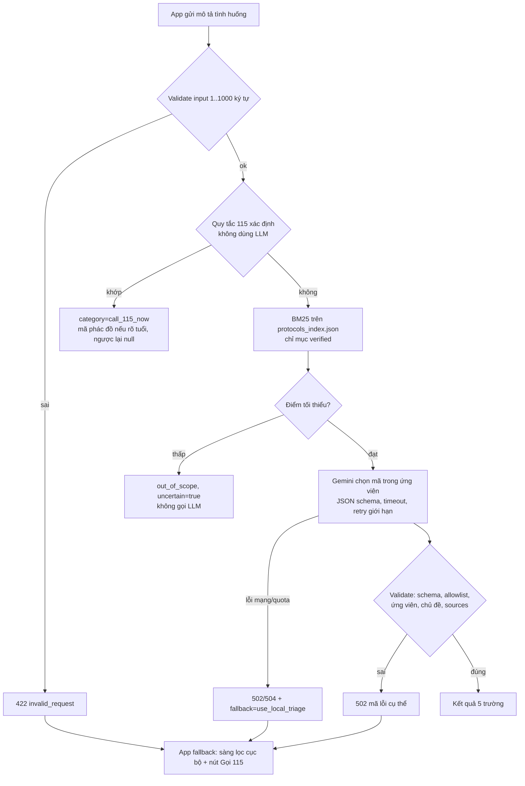
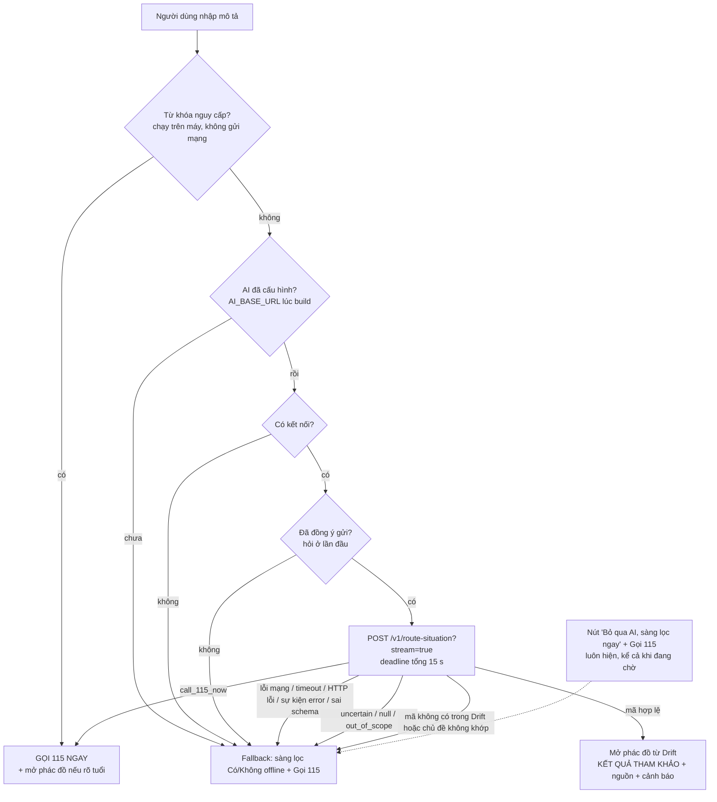
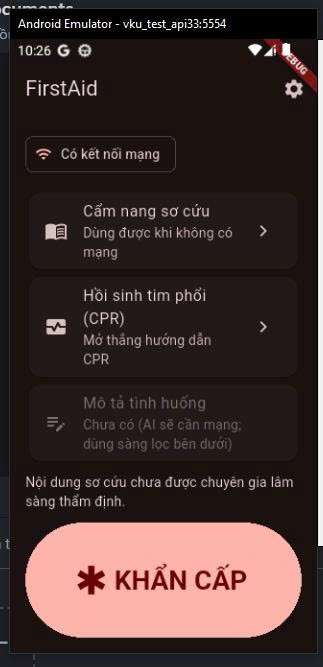

> Báo cáo bổ sung muộn, nộp gộp theo hướng dẫn của giảng viên; nội dung phản ánh trạng thái thực tế tại thời điểm viết.

# [REPORT 3] AI INTEGRATION, OFFLINE SYNC & TEST REPORT
**Course:** Cross-Platform Mobile App Development  
**Project Title:** FirstAid  
**Team Name:** [CHƯA CÓ BẰNG CHỨNG: tên nhóm] • **Academic Term:** Semester 1 (2026 - 2027) • **Deadline:** Week 11

---

## 1. ARTIFICIAL INTELLIGENCE CAPABILITIES & BENCHMARKS
* **Model Backbone:** Gemini qua SDK `google-genai` 2.33.0 (tên model cấu hình qua `GEMINI_MODEL`; mặc định `gemini-2.5-flash` CHƯA được xác minh bằng API). Dịch vụ FastAPI `backend/` + RAG-lite (BM25). Đã chạy eval với Gemini thật 2 lượt (2026-11-08, xem bên dưới). [CHƯA CÓ BẰNG CHỨNG: chưa deploy.] App Flutter đã tích hợp (Prompt 07, mục 1b) nhưng kiểm thử tự động bằng fake/mock; ngoài ra đã có một lần chạy thủ công app trên emulator gọi backend local thật (2026-11-10, E-031; chỉ vài lần thử, chưa phải đo đạc; chưa chạy trên điện thoại thật).
* **Vai trò của AI:** chỉ chọn một mã phác đồ trong số ứng viên truy xuất được (hoặc `null`). Không chẩn đoán, không kê thuốc, không sinh hướng dẫn sơ cứu; nội dung sơ cứu luôn lấy từ phác đồ cục bộ có trích dẫn. Hỗ trợ SSE: sự kiện trạng thái, mảnh đầu ra tạm (chưa validate) và kết quả cuối đã validate.

### Pipeline

### Số đo đã có (chỉ từ lệnh đã chạy; nhãn do nhóm tự gán và cần người dùng rà lại)
Nguồn: bộ 35 ca `backend/eval/cases.jsonl`. Các số này đo hành vi trên tập nhỏ do chính nhóm viết, không phải độ chính xác tổng quát; quy tắc, alias và nhãn do cùng nhóm tạo nên có tính vòng tròn.

| Chỉ số | Giá trị | Ghi chú | Nguồn |
|---|---|---|---|
| Unit/integration test backend (mock LLM) | 60 pass | validation, quy tắc, retrieval, retry/timeout, SSE, log không lộ nội dung | `docs/evidence/tests/backend-pytest-20261108-011903.log` |
| Quy tắc 115: recall trên ca nhãn "gọi 115" | 9/12 | 3 ca cố ý là "khoảng hở" (không có từ khóa) nên bị bỏ sót: đây là hạn chế đã biết | `docs/evidence/ai/eval-retrieval-20261108-010516.json` |
| Quy tắc 115: mã phác đồ khớp nhãn khi quy tắc kích hoạt | 9/9 | vòng tròn (nhóm viết cả quy tắc lẫn nhãn) | `docs/evidence/ai/eval-retrieval-20261108-010516.json` |
| Quy tắc 115: kích hoạt nhầm trên ca không nhãn 115 | 0/23 | | `docs/evidence/ai/eval-retrieval-20261108-010516.json` |
| Truy xuất: mã đúng nằm trong top-k (ca có nhãn, không qua quy tắc) | 12/14 | k=3, ngưỡng điểm 2.0 | `docs/evidence/ai/eval-retrieval-20261108-010516.json` |
| Truy xuất: mã đúng đứng đầu (top-1) | 9/14 | BM25 thuần, nhạy cách diễn đạt | `docs/evidence/ai/eval-retrieval-20261108-010516.json` |
| Cổng truy xuất chặn ca không nhãn (mơ hồ/ngoài phạm vi) | 4/12 | 8/12 vẫn lọt qua cổng, phải do LLM từ chối (xem mục eval LLM thật; mẫu rất nhỏ) | `docs/evidence/ai/eval-retrieval-20261108-010516.json` |
| Cổng chặn nhầm ca có nhãn | 1/14 | "Trẻ chạm vào bàn là đang nóng" (alias "bàn là" bị từ dừng "là" cắt) | `docs/evidence/ai/eval-retrieval-20261108-010516.json` |
| Mô phỏng lỗi LLM (fake) trả đúng mã lỗi và không có kết quả | 10/10 | timeout, treo, 500, 429, JSON hỏng, mã bịa, nguồn bịa, thừa trường, LLM sập nhưng rule 115 vẫn chạy, thiếu key | `docs/evidence/ai/eval-fallback-sim-20261108-010522.json` |
| Độ trễ rules+retrieval trong tiến trình (không LLM, không mạng) | p50 0.09 ms, p95 0.14 ms (n=35) | không phải độ trễ người dùng cảm nhận | `docs/evidence/ai/eval-retrieval-20261108-010516.json` |

### Eval LLM thật: lần 1 và lần 2 (gemini-2.5-flash, google-genai 2.33.0, 35 ca, nhãn tự gán)
Hai lượt cùng bộ ca (`cases_sha256` giống nhau), cùng commit `452abb3`, cùng cấu hình (top-k 3, ngưỡng 2.0, timeout 12 s, tối đa 2 lần gọi, nghỉ 1 s giữa các ca). Khác nhau: **lần 2 chạy sau khi sửa prompt** (nguồn của ứng viên viết đúng dạng JSON `{"source_id","pages"}` không có tiền tố `p`, thêm câu "chép nguyên văn") và thêm ghi `error_detail`/`raw_llm_output` vào file kết quả. Lần 1: 2026-11-08 02:02 (+07); lần 2: 02:14 (+07).

| Chỉ số | Lần 1 | Lần 2 | Ghi chú |
|---|---|---|---|
| Nguồn hợp lệ khi LLM trả mã (`llm_sources_valid_when_code_given`) | 0/3 (0%) | 5/5 (100%) | Lần 2 không còn lỗi `llm_invalid_sources` (lần 1 có 3). Mẫu rất nhỏ (n=5) và không cùng tập ca với lần 1 |
| Đúng mã trên các ca LLM/quy tắc/cổng có trả lời | 19/21 (90.5%) | 18/20 (90.0%) | Ca bị lỗi hạ tầng không được tính; tập ca trả lời của hai lượt khác nhau |
| Đúng mã trên cả 35 ca (lỗi tính là sai) | 19/35 (54.3%) | 18/35 (51.4%) | Bị kéo xuống chủ yếu bởi lỗi hạ tầng |
| `uncertain` khớp nhãn (trên ca có trả lời) | 19/21 | 18/20 | |
| Đầu ra LLM vượt schema (trên ca gọi LLM, bỏ lỗi hạ tầng) | 10/12 | 6/7 | Lần 1: 2 `llm_invalid_json`; lần 2: 1 |
| Lỗi hạ tầng → app phải fallback (`infra_failures_fallback_rate`) | 9/35 (25.7%) | **14/35 (40.0%)** | Lần 2: cả 14 ca đều `HTTP 429 (rate limited)` theo `error_detail`. Lần 1 chưa ghi chi tiết nên chưa biết mã lỗi |
| Độ trễ đường LLM p50 / p95 | 3002.9 ms / 3858.2 ms (n=7) | 2698.0 ms / 3244.1 ms (n=6) | Gồm mạng tới Gemini, đo trong tiến trình, không gồm hop HTTP tới backend |
| Ca đi qua quy tắc 115 / cổng truy xuất | 9 / 5 | 9 / 5 | Xác định, không phụ thuộc LLM |

Nguồn: `docs/evidence/ai/eval-llm-20261108-020235.json` (lần 1), `docs/evidence/ai/eval-llm-20261108-021429.json` (lần 2).

**Diễn giải và giới hạn (cần nêu khi trình bày)**
* **Nguồn hợp lệ 0/3 → 5/5:** nhất quán với giả thuyết nguyên nhân là định dạng `pXXX-YYY` trong prompt cũ không khớp trích dẫn trong chỉ mục (`288-290`). Chưa xác nhận trực tiếp vì lần 1 không lưu đầu ra thô. Lần 2 chưa có ca lỗi nguồn nào để kiểm tra. Mẫu n=5 là quá nhỏ để khẳng định tỷ lệ 100%.
* **Rate limit:** 14/35 ca (40%) lần 2 gặp HTTP 429 nên không có kết quả LLM; chỉ 6 ca còn lại đi tới đầu ra LLM. Mọi tỷ lệ LLM ở trên vì vậy rất không ổn định, và hai lượt không so sánh trực tiếp được (tập ca trả lời khác nhau). Người dùng cho biết đang dùng gói miễn phí; file kết quả chỉ ghi `HTTP 429`, không ghi gói tài khoản. Cấu hình retry hiện tại (tối đa 2 lần gọi, backoff 0,5 s) không đủ vượt 429; hướng giảm thiểu dự kiến khi deploy: retry + backoff dài hơn, tăng thời gian nghỉ giữa lời gọi, hoặc nâng hạn mức (chưa làm). Khi hết quota, app phải fallback sang sàng lọc cục bộ.
* **`llm_invalid_json` còn lại (c18, lần 2):** đầu ra thô chỉ 28 ký tự và dừng giữa chừng (`{"category": "out_of_scope", "`), phù hợp với đầu ra bị cắt. Nguyên nhân chưa xác nhận (nghi `max_output_tokens=600`); chưa sửa.
* Nhãn do nhóm tự gán và cần người dùng rà lại; số đo chỉ mô tả hành vi trên tập nhỏ này, không phải độ chính xác tổng quát.

### CHƯA ĐO
| Chỉ số | Trạng thái |
|---|---|
| Kết quả LLM cho 14 ca bị HTTP 429 ở lần 2 | CHƯA ĐO (cần chạy lại khi hết giới hạn tốc độ) |
| Time to first token (SSE) | CHƯA ĐO |
| Tỷ lệ trên mẫu đủ lớn/ổn định (mẫu LLM hiện chỉ 6–7 ca/lượt) | CHƯA ĐO |
| Fallback khi mất mạng thật hoặc timeout thật (mới thấy 429 thật; các lỗi khác chỉ mô phỏng bằng fake) | CHƯA ĐO |

* **Metric RAM/bộ nhớ model:** không áp dụng cho AI chạy trên cloud: mô hình nằm trên máy chủ của Google, app chỉ là HTTP client; bộ nhớ phía app khi gọi API chưa đo. Không mô tả AI cloud là hoạt động offline: khi mất mạng, app dùng sàng lọc cục bộ.
* **Hạn chế:** chỉ phủ 4 chủ đề; dữ liệu truy xuất lấy từ phác đồ `not_clinically_reviewed`; nội dung tình huống đi tới Gemini (bên thứ ba) khi dùng đường LLM; endpoint công khai có rủi ro lạm dụng quota; danh sách từ khóa quy tắc chưa được rà soát lâm sàng.

### 1b. Tích hợp app và fallback an toàn (Prompt 07)
Màn "Mô tả tình huống" (`app/lib/presentation/screens/describe_situation_screen.dart`) gọi use case `RouteSituation` (`app/lib/domain/usecases/route_situation.dart`). AI chỉ trả mã; app mở phác đồ **từ Drift** theo `protocol_code` và hiển thị tiêu đề, nguồn, phiên bản, cảnh báo chưa thẩm định cùng nhãn "KẾT QUẢ THAM KHẢO" (không phải chẩn đoán). App **không hiển thị** `confidence_note` hay bất kỳ văn bản nào do LLM sinh; sự kiện SSE `delta` chỉ được đếm số ký tự để báo tiến trình.

| Điều kiện | Hành vi của app | Kiểm thử tự động |
|---|---|---|
| Mất mạng (connectivity báo không có kết nối) | Fallback ngay, không hỏi đồng ý, không gọi AI | unit + widget |
| Không tới được máy chủ (lỗi mạng/DNS/TLS dù "có kết nối") | Fallback | unit (`network`) + data (`ClientException`) |
| Timeout: deadline tổng phía app (mặc định 15 s, `AI_TIMEOUT_SECONDS`) hoặc server trả `llm_timeout`/HTTP 504 | Fallback; hết giờ thì hủy yêu cầu HTTP | unit (deadline 50 ms, xác nhận hủy) + widget + data |
| Lỗi máy chủ (HTTP != 200, sự kiện `error`, ví dụ 429 → `llm_unavailable`) | Fallback | unit + widget + data |
| Phản hồi sai schema (thừa/thiếu trường, category lạ, JSON hỏng) hoặc kết thúc không có `result` | Fallback | data + unit |
| `uncertain = true`, `protocol_code = null`, `out_of_scope` | Fallback | unit + widget |
| Mã không có trong allowlist cục bộ (Drift) hoặc chủ đề phác đồ khác `category` | Fallback | unit + widget |
| Từ khóa nguy cấp (quy tắc cục bộ) hoặc server trả `call_115_now` | Thẻ "GỌI 115 NGAY" + nút Gọi 115; mở phác đồ nếu xác định được tuổi | unit + widget |
| Chưa cấu hình `AI_BASE_URL` (R-33, D-061) | Màn hiện ngay thẻ "Ứng dụng chưa được cấu hình máy chủ AI" + nút sàng lọc offline từ lúc mở màn; không hỏi đồng ý, không kiểm tra mạng, không hiện thông báo gửi dữ liệu; từ khóa 115 vẫn kiểm tra trên máy | unit + widget (có đối chứng) |
| Người dùng bấm "Bỏ qua AI, sàng lọc ngay" khi đang chờ | Hủy yêu cầu ngay, chuyển sang sàng lọc | widget (xác nhận hủy subscription) |

* **Quyền riêng tư:** khi AI đã được cấu hình, màn hiện thông báo văn bản mô tả được gửi tới máy chủ của nhóm và Gemini (bên thứ ba); khi chưa cấu hình (như bản release v0.1.0) không có gì được gửi nên thông báo và hộp thoại đồng ý đều không hiện (D-061). Trước lần gửi đầu tiên app hỏi đồng ý; từ chối thì không gửi và gợi ý sàng lọc offline. Lựa chọn lưu trong Cài đặt (có công tắc bật/tắt). Hộp thoại chỉ xuất hiện ngay trước khi gửi, sau kiểm tra từ khóa nguy cấp và kết nối, nên ca nguy cấp và ca mất mạng không bị chặn bởi hộp thoại.
* **Quy tắc 115 trên máy:** `detectEmergencyKeywords` là bản port 1-1 của `backend/app/rules.py` (cùng danh sách cụm, chưa rà soát lâm sàng). Kiểm tra chéo một lần trên 35 ca `backend/eval/cases.jsonl`: Dart và Python cho cùng (luật, mã) 35/35 (9 ca kích hoạt ở cả hai). Đây là so sánh hai bản cài đặt, không phải độ chính xác lâm sàng; hai bản phải sửa đồng thời (R-28).
* **Bằng chứng:** `docs/evidence/tests/ai-integration-checks-20261110-002444.log` (format 0 changed, analyze "No issues found", 119 test pass, kèm kết quả kiểm tra chéo 35/35); build APK debug `docs/evidence/tests/build-apk-debug-20261110-002726.log` (exit=0). Test mới: `app/test/domain/route_situation_test.dart`, `app/test/data/http_ai_router_repository_test.dart`, `app/test/describe_situation_test.dart`.
* **Chạy thủ công app → backend thật (E-031, 2026-11-10):** app Flutter (debug) trên emulator Android `vku_test_api33` gọi backend FastAPI chạy local trên máy phát triển qua `AI_BASE_URL=http://10.0.2.2:8000` (theo lời người chạy; URL không xuất hiện trong log/ảnh). Log backend `docs/evidence/ai/app-to-backend-run-20261110.txt` có đúng 1 dòng: `route ok ... source=llm code=burns_thermal_chemical uncertain=False text_len=25 ms=2962`, xác nhận một yêu cầu đi qua đường LLM (Gemini). Ảnh `docs/evidence/screenshots/ai-describe-result-burns-emulator.png` cho thấy thẻ "Bỏng nhiệt và bỏng hóa chất" kèm cảnh báo chưa thẩm định lâm sàng và nút Gọi 115; `ai-describe-result-115-emulator.png` cho thấy thẻ "GỌI 115 NGAY" do quy tắc từ khóa chạy trên máy (không gửi đi, theo chữ trong thẻ); `ai-fallback-offline-emulator.png` cho thấy thẻ "Không có mạng..." với nút "Bắt đầu sàng lọc offline" khi thanh trạng thái có biểu tượng máy bay (văn bản nhập 25 ký tự). **Giới hạn:** emulator, không phải điện thoại thật; backend local, chưa deploy; chỉ vài lần thử thủ công, không phải đo độ trễ hay độ chính xác từ phía app (`ms=2962` là thời gian xử lý ghi bởi backend cho một yêu cầu, không phải số đo có ý nghĩa thống kê); chưa kiểm chứng SSE với Gemini thật ở mức time to first token; log chỉ có 1 dòng nên không chứng minh được ảnh "bỏng" tương ứng đúng dòng log đó (giờ log 10:43, giờ trên ảnh 11:07–11:08; mã phác đồ và độ dài 25 ký tự khớp nhưng không đủ để khẳng định); ảnh offline cho thấy kết quả hiển thị nhưng không cho biết nguyên nhân nội bộ (mất kết nối hay lỗi khác).
* **Bản release v0.1.0 (E-038, E-039)** build bởi GitHub Actions không truyền `--dart-define` nên **không có AI và không có Supabase** (R-33). Ảnh `docs/evidence/screenshots/release-v0.1.0-ai-not-configured-emulator.png` (emulator) cho thấy thẻ "Ứng dụng chưa được cấu hình máy chủ AI." và không thấy hộp thoại đồng ý hay dòng thông báo quyền riêng tư. Muốn bản release dùng AI phải build lại với `AI_BASE_URL` (https) và backend đã deploy: chưa làm.
* **Video kịch bản online → AI → tắt mạng → fallback:** [CHỜ NGƯỜI DÙNG QUAY VIDEO] (hướng dẫn: `docs/evidence/android-device-run.md`, mục Prompt 07).

| Chưa đo / chưa kiểm chứng (app) | Trạng thái |
|---|---|
| App gọi backend thật trên **điện thoại thật** hoặc backend **đã deploy** | CHƯA CHẠY (chỉ mới chạy trên emulator với backend local, xem bên dưới) |
| Độ trễ người dùng cảm nhận, time to first token trong app | CHƯA ĐO |
| Deadline 15 s có phù hợp mạng di động thật không | CHƯA ĐO (giá trị do nhóm chọn) |
| Time to first token của SSE với Gemini thật, đo từ phía app | CHƯA ĐO / CHƯA KIỂM CHỨNG |
| Độ chính xác định tuyến đo từ phía app (số ca thủ công quá ít) | CHƯA ĐO |
| Fallback khi "có sóng nhưng không có Internet" trên máy thật | CHƯA KIỂM CHỨNG (chỉ fake) |

---

## 2. OFFLINE-FIRST SYNCHRONIZATION ENGINE
* Local persistence Drift/SQLite đã triển khai, có test tự động trên SQLite in-memory (log `docs/evidence/tests/drift-seed-checks-20261106-010345.log`). Luồng khẩn cấp đã chạy ở chế độ máy bay trong integration test trên emulator Android 13 (mục 3.1, E-028). [CHƯA CÓ BẰNG CHỨNG: chưa chạy trên điện thoại thật; ảnh chụp chế độ máy bay: docs/evidence/offline-manual-test.md.]

| Chức năng | Offline? | Ghi chú |
|---|---|---|
| Cẩm nang 6 phác đồ (bước, không nên làm, khi nào gọi 115, nguồn, phiên bản) | Thiết kế: có (đọc từ SQLite) | Chưa kiểm chứng trên máy thật |
| Cây quyết định triage tĩnh (màn Sàng lọc, Prompt 03) | Thiết kế: có | Luật xác định, không phải AI; là đích fallback của AI |
| Cảnh báo chưa thẩm định lâm sàng | Có | Hiển thị ở danh sách và chi tiết |
| AI định tuyến (LLM + RAG-lite) | Không | Cần mạng. App đã tích hợp (mục 1b): mất mạng/timeout/lỗi/uncertain/mã lạ → sàng lọc tĩnh; từ khóa nguy cấp kiểm tra trên máy (offline) → Gọi 115. Đã chạy thủ công một lần trên emulator với backend local (mục 1b, E-031); chưa chạy trên điện thoại thật hay backend đã deploy |
| SOS: gọi 115, vị trí, SMS | Gọi/nhắn cần sóng di động; tọa độ GPS không cần Internet | Đã code + test (Prompt 04, xem R2); chưa thử trên máy thật |
| Đồng bộ phác đồ từ Supabase | Cần mạng để cập nhật; đọc phác đồ vẫn offline | Code + test bằng fake remote; chưa thử với Supabase thật |
### Chính sách xung đột và đồng bộ (Prompt 05)
* **Phác đồ:** server version thắng, nhưng CHỈ nhận bản `clinical_review = reviewed` và `source_verification = verified`, và chỉ khi version mới hơn bản trên máy (so sánh số). Bản chưa review không bao giờ ghi đè bản ổn định.
* **Ghi local:** toàn bộ phác đồ nhận về ghi trong một transaction; lỗi giữa chừng thì rollback, giữ bản cũ. Mất mạng hoặc sync lỗi: giữ bản local, UI không đổi.
* **Seed asset:** khi asset đổi version, seed không ghi đè phác đồ đã nhận từ server có version >= asset; asset mới hơn thì asset thắng.
* **Log SOS:** append-only, chỉ gửi khi người dùng đồng ý; ID UUID do client sinh nên gửi lại không nhân đôi (trùng khóa chính coi là đã gửi).
* **Hàng đợi:** lưu bằng Drift (`sync_jobs`), retry tối đa 5 lần, backoff mũ 30 s x 2^(n-1) tối đa 1 giờ; lỗi vĩnh viễn (RLS từ chối, dữ liệu sai) chuyển `failed` ngay. Đồng bộ chạy khi khởi động nếu có kết nối và mỗi khi kết nối quay lại.
* **Đã kiểm chứng (test tự động, fake remote, SQLite in-memory):** retry/backoff, hết lần retry, lỗi vĩnh viễn, idempotency, offline -> online, lọc bản chưa review, rollback, seed không ghi đè, migration v1 -> v2 (kiểm tra thu gọn trên bảng `meta`). Log: `docs/evidence/tests/sync-checks-20261107-234308.log`.
* **CHƯA kiểm chứng:** chạy với Supabase thật, RLS thật, mạng thật trên điện thoại, kết nối "có sóng nhưng không có Internet" (connectivity chỉ cho biết có kết nối).

---

## 3. AUTOMATED TEST SUITE & PERFORMANCE PROFILING
### 3.1 Bộ test tự động (Prompt 08)
* **Kết quả:** 155 test pass tại thời điểm đo coverage (`flutter test --coverage`), `flutter analyze` "No issues found", `dart format` 0 file thay đổi. Log: `docs/evidence/tests/quality-checks-20261110-013916.log`. Sau bản sửa R-33 (2026-11-11) bộ test là **159 pass**, analyze sạch, format 0 changed (`docs/evidence/tests/r33-hide-privacy-notice-checks-20261111-233445.log`); coverage ở mục 3.2 **chưa đo lại** sau lần sửa đó.
* **Phân loại:** unit test use case/domain (với fake repository), test Data (Drift SQLite in-memory, `MockClient` cho SSE, SharedPreferences mock, mapper Supabase), widget test từng màn và trạng thái, test kiến trúc (Domain không import framework), test accessibility (mục 3.3).
* **Integration test (thiết bị):** `app/integration_test/emergency_offline_test.dart`, chạy trên **emulator** Android 13 (`sdk_gphone64_x86_64`, AVD `vku_test_api33`) ở **chế độ máy bay** (`airplane_mode_on=1`, `Active default network: none`). Dùng thật: asset phác đồ/sàng lọc, SQLite, `connectivity_plus`, router. Fake: trình quay số, TTS, vị trí, SMS. Luồng: chip "Không có mạng" → KHẨN CẤP → 3 câu trả lời → CPR bước 1→2 → Gọi 115 → Mô tả tình huống → fallback offline (không hỏi đồng ý, không gửi) → sàng lọc. **Pass** ở lần chạy cuối: `docs/evidence/tests/integration-emergency-offline-20261110-012638.log`. Bốn log trước được giữ lại: lần 1–3 fail do lỗi của chính test (chờ bất đồng bộ chưa đủ, nút ngoài màn hình, thẻ kết quả ngoài vùng nhìn thấy); lần 3 dẫn tới sửa UX ở mục 3.4. Chưa chạy trên điện thoại thật.

### 3.2 Coverage (số thật từ lcov, Flutter 3.47.6)
Nguồn: `docs/evidence/tests/coverage-20261110-013916.lcov.info`; bảng theo file và theo lớp: `docs/evidence/tests/coverage-summary-20261110-013916.md` (sinh bằng `app/tool/coverage_summary.dart`).

| Phạm vi | Dòng hit / tổng | % |
|---|---|---|
| Toàn bộ file trong lcov (63 file, gồm `app_database.g.dart` do drift_dev sinh) | 2010 / 3429 | 58.62% |
| Không tính file sinh tự động `*.g.dart` (62 file) | 1495 / 1716 | 87.12% |
| Lớp domain | 272 / 280 | 97.14% |
| Lớp presentation | 685 / 708 | 96.75% |
| Lớp data (gồm `.g.dart`) | 998 / 2336 | 42.72% |
| core | 34 / 67 | 50.75% |

* Phần trăm tính từ đúng hai số nguyên bên cạnh, làm tròn 2 chữ số. Coverage là **dòng** (line), không phải nhánh.
* Phủ thấp (có chủ đích hoặc chưa làm): wrapper nền tảng chỉ chạy trên thiết bị: `connectivity_plus_service` 0/8, `flutter_tts_service` 0/10, `geolocator_location_service` 1/22, `url_launcher_dialer_service` 1/3; `supabase_remote_sync_source` 0/33 (cần Supabase thật); `app_config` 0/9 (đọc `--dart-define`); `app_database.dart` 8/62 (nhánh migration); `main.dart` 21/38.
* lcov không liệt kê 11 file chỉ có interface/enum (không có dòng thực thi) và **không gồm** integration test.

### 3.3 Material 3, Dark Mode, accessibility (kiểm tra tự động)
`app/test/accessibility_test.dart`, màn hình 360×800 dp:
* 7 màn chính (Home, Sàng lọc, Hướng dẫn CPR, Cẩm nang, Cài đặt, SOS, Mô tả tình huống) × 2 theme (Sáng/Tối) = 14 test, mỗi test kiểm 3 guideline của Flutter: `androidTapTargetGuideline` (vùng chạm ≥ 48 dp), `labeledTapTargetGuideline` (mọi nút có nhãn), `textContrastGuideline` (tương phản chữ theo WCAG). Tất cả pass.
* Cỡ chữ 200% trên 7 màn: không tràn layout và **không có chữ bị cắt** (bộ phát hiện tự viết so chiều cao cần để vẽ chữ với chiều cao được cấp).
* 2 test **đối chứng** chứng minh các kiểm tra trên thật sự bắt lỗi (nút 20×20 không nhãn + chữ tương phản thấp → trượt; chữ to trong nút cao cố định → bị phát hiện cắt).
* Theme: `useMaterial3: true`, sáng/tối từ cùng `ColorScheme.fromSeed`; không có màu cứng trong `lib/presentation` ngoài màu seed. Thông tin quan trọng có chữ + icon (không chỉ dựa vào màu).
* Giới hạn: test dùng font Ahem (mỗi ký tự vuông, rộng hơn font thật) nên kiểm tra cỡ chữ là bảo thủ; contrast chỉ đo trong widget test; **chưa xem Dark Mode trên điện thoại thật** ([CHỜ NGƯỜI DÙNG CHỤP], xem docs/evidence/screenshots/emergency_ui.md). Có một ảnh Dark Mode trên emulator (màn Home, debug, 2026-11-06): `docs/evidence/screenshots/home-dark-emulator-20261106.png`.

### 3.4 Lỗi tìm ra và đã sửa
| Vấn đề | Cách phát hiện | Sửa |
|---|---|---|
| Ở cỡ chữ 200%, chữ bị cắt trong 14 nút có chiều cao cố định (KHẨN CẤP, Gọi 115, Trước/Tiếp, Bỏ qua AI...) mà Flutter không báo lỗi | test cỡ chữ lớn + bộ phát hiện cắt chữ | `SizedBox(height: N)` → `ConstrainedBox(minHeight: N)`: nút giữ kích thước tối thiểu, cao lên theo chữ |
| App **ghi đè** cỡ chữ hệ thống Android bằng hệ số trong Cài đặt (người dùng đặt chữ to trong Android không có tác dụng) | rà code `main.dart` | `AppTextScaler`: cỡ chữ hệ thống × hệ số app, chặn trên 2.0 (mức đã kiểm thử); có test |
| Trên màn nhỏ/bàn phím ảo, thẻ kết quả/fallback của "Mô tả tình huống" nằm ngoài vùng nhìn thấy | integration test lần 3 trên emulator | tự cuộn tới thẻ khi có kết quả; widget test 360×640 pass, và fail khi tắt tính năng (đối chứng); integration test lần 5 pass không cuộn thủ công |

### 3.5 Tối ưu chỗ nghi ngờ jank (chưa đo trước/sau: [CHỜ SỐ ĐO THẬT])
| Thay đổi | Lý do |
|---|---|
| `AppTheme` dựng `ThemeData` một lần rồi dùng lại (trước: dựng lại mỗi lần `FirstAidApp` build) | `ColorScheme.fromSeed` tính bảng màu; app rebuild mỗi khi cài đặt đổi, kể cả từng frame khi kéo thanh cỡ chữ |
| Thanh cỡ chữ: `onChanged` chỉ đổi state, `onChangeEnd` mới ghi SharedPreferences | Trước đây ghi đĩa ở mọi frame khi kéo |
| Cẩm nang: provider tìm kiếm `autoDispose`; giữ danh sách cũ trong lúc truy vấn mới chạy | Trước đây mỗi phím gõ thay danh sách bằng vòng xoay (nháy, layout lại cả màn) và giữ provider cũ mãi |
| Bật lint `prefer_const_*`, `use_colored_box`, `sized_box_for_whitespace`; `dart fix` sửa 2 chỗ còn thiếu `const` | Widget `const` được Flutter bỏ qua khi rebuild; code vốn đã gần như dùng `const` đầy đủ |
| `AppTextScaler` so sánh bằng nhau theo giá trị | Tránh `MediaQuery` đổi giá trị (và rebuild cây con) khi cỡ chữ không đổi |

### 3.6 Frame rate
* **Frame Rate:** [CHỜ SỐ ĐO THẬT]. Hướng dẫn đo profile mode trên máy thật: `docs/evidence/fps/README.md`; bảng điền số: `docs/evidence/fps/fps-measurements.md`. Perf test lặp lại được: `app/integration_test/perf_test.dart` + `app/test_driver/perf_driver.dart` (`flutter drive --profile --no-dds`, xuất frame build/raster time và số frame vượt 16 ms).
* Perf test mới được **chạy thử luồng** ở debug trên emulator (`docs/evidence/tests/perf-test-smoke-20261110-013449.log`, 3/3 pass) để xác nhận kịch bản chạy hết; đây **không phải số đo** và không có số nào được ghi.
* **🔗 Internal Testing APK Link:** APK/AAB v0.1.0 ký bằng keystore của nhóm đã được tạo bởi release workflow (run #1, tag v0.1.0, commit c0fcdec; E-038: apksigner v2 verified, jarsigner "jar verified."), là bản offline-only (R-33). [CHƯA CÓ: link tải công khai ổn định. Artifact của GitHub Actions chỉ giữ 30 ngày và cần đăng nhập GitHub để tải; cần đưa lên GitHub Release hoặc Google Drive trước khi nộp.] Link run: https://github.com/lddatitvku0202/firstaid-capstone/actions/runs/43144492260.
