# [REPORT 4] FINAL CAPSTONE REPORT & DEFENSE DOSSIER
**Capstone Project:** Cross-Platform Mobile App Development  
**Official Project Title:** FirstAid – Ứng dụng trợ lý sơ cứu khẩn cấp ngoại tuyến và kết nối hỗ trợ cộng đồng / Offline-First Emergency First Aid Assistant & Community Support App  
**Student Team:** [CHƯA CÓ BẰNG CHỨNG: tên nhóm, thành viên, MSSV và % đóng góp do nhóm tự điền] • **Deadline:** Week 13  
**Trạng thái tài liệu:** tổng hợp ngày 2026-11-12 từ sổ bằng chứng `docs/evidence-ledger.md` (E-001 đến E-039). Mọi con số trong báo cáo lấy từ lệnh/file đã có trong repo kèm đường dẫn; chỗ chưa có dữ liệu ghi `[CHỜ ...]` hoặc `[CHƯA CÓ BẰNG CHỨNG]`.

---

## 📑 TABLE OF CONTENTS
* CHAPTER 1: INTRODUCTION & PROBLEM SPACE
* CHAPTER 2: REQUIREMENTS ANALYSIS & MOBILE UI/UX DESIGN
* CHAPTER 3: SYSTEM DESIGN & CLEAN ARCHITECTURE
* CHAPTER 4: ADVANCED CAPABILITIES & ARTIFICIAL INTELLIGENCE
* CHAPTER 5: TESTING, PERFORMANCE PROFILING & EVALUATION (gồm 5.3 CI/CD và ký số release)
* CHAPTER 6: CONCLUSION, LESSONS LEARNED & FUTURE WORK
* APPENDIX A: Trạng thái 5 tiêu chuẩn bắt buộc • APPENDIX B: Rủi ro chính • APPENDIX C: Chỉ mục bằng chứng

---

## 📦 FINAL DEFENSE DELIVERABLES CHECKLIST
1. Comprehensive Final Technical Report (PDF) — R1 đến R4 xuất PDF bằng Python (markdown → HTML) và Chrome headless vào `dist/FirstAid_Capstone_Submission/`. [CHƯA CÓ: link Google Drive công khai, do nhóm tạo]
2. Oral Defense Slide Deck (10–12 slides) — bản Markdown 11 trang: `docs/slides/FirstAid_Defense_Slides.md` (không phải file .pptx).
3. Production-Signed Release Binary (APK/AAB/IPA) — APK + AAB v0.1.0 ký bằng keystore của nhóm (chứng chỉ tự ký, CN=FirstAid Team) do release workflow tạo trên GitHub Actions (run #1, commit c0fcdec; E-038), cài thử được trên emulator (E-039). Bản offline-only (R-33). [CHƯA CÓ: link tải công khai ổn định (artifact Actions hết hạn sau 30 ngày); chưa thử trên điện thoại thật; IPA không áp dụng (chỉ Android)]
4. Clean GitHub Code Repository (main branch) — https://github.com/lddatitvku0202/firstaid-capstone (có README, lịch sử commit, tag `v0.1.0`). Repo đang public; không chứa PDF y khoa, `.env`, keystore.
5. High-Definition Demo Video (3–5 minutes) on a physical device — [CHƯA CÓ BẰNG CHỨNG: chưa quay; chưa có điện thoại Android thật cắm máy]

---

## CHAPTER 1: INTRODUCTION & PROBLEM SPACE

### 1.1 Bối cảnh và vấn đề
Nguồn: `docs/source/description/FirstAid_Mo_ta_de_tai_hieu_chinh_Capstone.docx` (mục 1–2). Trong tình huống sơ cứu khẩn cấp, người chứng kiến có thể hoảng loạn, quên trình tự thao tác, khó đánh giá thông tin trên Internet, gặp mẹo truyền miệng nguy hiểm, hoặc không có mạng ổn định để tra cứu. Đề tài FirstAid xây dựng một ứng dụng di động giúp người dùng mở nhanh một luồng sơ cứu có kiểm soát, **chạy được khi không có mạng**, và chỉ dùng nội dung có trích dẫn nguồn.

Đối tượng người dùng theo mô tả đề tài: người dân, sinh viên, người đi đường, gia đình, người làm việc ngoài hiện trường, tình nguyện viên. [CHƯA CÓ BẰNG CHỨNG: persona chi tiết (tuổi, nghề nghiệp, pain points) và khảo sát người dùng chưa được thực hiện.]

### 1.2 Mục tiêu của đồ án
Theo 5 tiêu chuẩn bắt buộc của học phần (`docs/source/5_tieu_chuan_bat_buoc.png`):
1. Clean Architecture 3 lớp nghiêm ngặt (Domain, Data, Presentation).
2. Ít nhất một tính năng AI thực sự (Streaming LLM API).
3. Offline-First: CSDL cục bộ (Drift/SQLite) cộng Cloud BaaS (Supabase).
4. Material 3, hỗ trợ Dark Mode, 60fps.
5. Tự động ký số release APK/AAB qua Fastlane CI/CD.

Mục tiêu an toàn do nhóm đặt thêm (CLAUDE.md §6): nội dung sơ cứu chỉ từ tài liệu nguồn có trích dẫn; AI chỉ định tuyến tới mã phác đồ có sẵn, không chẩn đoán, không kê thuốc; luồng cốt lõi chạy khi mất mạng; luôn hiện cảnh báo khi nội dung chưa được thẩm định lâm sàng.

### 1.3 Phạm vi thực hiện
**Đã triển khai (MVP):** chế độ khẩn cấp (sàng lọc Có/Không), cẩm nang offline 6 phác đồ (4 chủ đề: CPR, hóc dị vật, chảy máu nặng, bỏng), hướng dẫn từng bước kèm đọc to (TTS), SOS (gọi 115, tọa độ, SMS soạn sẵn có xác nhận), Mô tả tình huống với AI định tuyến và fallback an toàn, Cài đặt (Sáng/Tối/Hệ thống, cỡ chữ), đồng bộ Supabase ở mức code + test với fake remote, backend FastAPI RAG-lite, CI/CD và ký số release.

**Chưa triển khai (ghi ở Future Work, mục 6.4):** bộ đếm nhịp CPR (Should-Have trong đề xuất), bản đồ điểm hỗ trợ và cộng đồng tình nguyện viên (Could-Have), vision triage, cảm biến hỗ trợ CPR, màn đăng nhập và giao diện đồng ý cho log SOS.

### 1.4 Nhóm thực hiện và phân công
[CHƯA CÓ BẰNG CHỨNG: danh sách thành viên, vai trò, MSSV, % đóng góp: nhóm tự điền. Báo cáo này không tự suy ra số liệu đóng góp.]

### 1.5 Cách đọc báo cáo (quy tắc trung thực)
- Mọi số đo trích dẫn tới file/log trong `docs/evidence/` và dòng tương ứng của sổ bằng chứng (E-xxx).
- `[CHỜ ...]`: nhóm cần đo hoặc quay thêm (FPS trên máy thật, video demo). `[CHƯA CÓ BẰNG CHỨNG]`: chưa có dữ liệu.
- Các số trong template gốc (ví dụ 85 ms, 94,2%, +45 MB, ≥ 80%) chỉ là mẫu và **không** được dùng.
- Kiểm thử và bản build chạy trên **emulator Android 13** (`vku_test_api33`) và trên GitHub Actions; **chưa chạy trên điện thoại Android thật**.

---

## CHAPTER 2: REQUIREMENTS ANALYSIS & MOBILE UI/UX DESIGN

### 2.1 Yêu cầu chức năng và trạng thái
| # | Chức năng | Ưu tiên (đề xuất) | Trạng thái | Bằng chứng |
|:---:|---|:---:|---|---|
| 1 | Chế độ khẩn cấp một chạm, không cần tài khoản | Must | Đã triển khai | E-009, E-028 |
| 2 | Cẩm nang sơ cứu offline, tìm kiếm không dấu, hiển thị nguồn và phiên bản | Must | Đã triển khai (6 phác đồ IFRC-2025) | E-006, E-007, E-009 |
| 3 | SOS: gọi 115, tọa độ GPS, SMS soạn sẵn do người dùng tự gửi | Must | Đã triển khai; chưa thử trên máy thật | E-011 |
| 4 | AI hỗ trợ tìm đúng phác đồ (streaming, RAG-lite) | Must | Backend + app đã có; backend đã deploy trên Render (2026-11-12, một lần gọi thử, chưa có số đo; E-042); bản release v0.1.0 offline-only | E-017..E-022, E-031 |
| 5 | Bộ đếm nhịp CPR (100–120 nhịp/phút) | Should | **Chưa triển khai** | — |
| 6 | Bản đồ điểm hỗ trợ, cộng đồng tình nguyện viên | Could | **Chưa triển khai** | — |
| 7 | Đọc to từng bước (TTS vi-VN) | (thuộc mục 1–2) | Đã triển khai; giọng vi-VN thật chưa kiểm chứng trên máy | E-009, R-11 |
| 8 | Đồng bộ phác đồ và hàng đợi log SOS với Supabase | (thuộc tiêu chuẩn 3) | Code + test fake remote; RLS 13/13 PASS; app chưa thử với Supabase thật; log SOS chưa nối UI | E-014, E-015 |

### 2.2 Yêu cầu phi chức năng
| Yêu cầu | Cách đáp ứng | Mức kiểm chứng |
|---|---|---|
| Chạy khi mất mạng | Dữ liệu phác đồ và cây sàng lọc trong SQLite; AI chỉ là lớp tùy chọn; từ khóa 115 kiểm tra trên máy | Integration test ở chế độ máy bay trên emulator (E-028); chưa thử trên máy thật |
| An toàn thông tin y tế | Chỉ nội dung từ nguồn có trích dẫn; AI chỉ trả mã; cảnh báo chưa thẩm định luôn hiển thị | Test widget (cảnh báo), validation backend |
| Truy cập được (accessibility) | Vùng chạm ≥ 48 dp, nhãn nút, tương phản, cỡ chữ đến 200%, không dựa vào màu đơn thuần | 14 test guideline + 7 test cỡ chữ (E-027) |
| Quyền riêng tư | Xin đồng ý trước khi gửi mô tả tới máy chủ AI; không SEND_SMS; không background location; log SOS chỉ khi đồng ý | Test + review; UI đồng ý cho log SOS chưa có (R-19) |
| Bảo mật cấu hình | Không hardcode secret; `.env`, keystore, `key.properties` gitignore | Review + CI chạy với Secrets (E-038) |
| Hiệu năng 60fps | Tối ưu rebuild (R3 mục 3.5) | **[CHỜ SỐ ĐO THẬT]** |

### 2.3 Nguồn nội dung y khoa
- Nguồn nội dung chính: **IFRC-2025** (International First Aid, Resuscitation and Education Guidelines 2025), `source_verification = verified` trong `docs/source/medical/source_register.csv`. Phác đồ trong app là **bản tóm lược và dịch tiếng Việt của nhóm**, đã gắn số trang trích dẫn (p114, 159-162, 187-188, 238-242, 256-258, 288-290; E-007).
- Nguồn Việt Nam (VN-MOH-636-2025, VN-BYT-MOET-TNTT-2022) **chưa dùng** vì PDF không trích được text (D-008, R-10). Hóc dị vật người lớn chỉ có ở IFRC-2025 (`docs/source/medical/SOURCE_MAP.md`).
- Trạng thái: `clinical_review = not_clinically_reviewed`: **chưa có chuyên gia y tế rà soát**; app luôn hiển thị cảnh báo (R-03, R-08, R-13).
- Bản quyền: file PDF không nằm trong repo public; repo chỉ lưu metadata, URL, checksum (R-02, D-003).

### 2.4 Thiết kế giao diện và vai trò của Figma
Figma là **prototype định hướng luồng màn hình** (link: `docs/source/figma/figma_link.md`); **giao diện cuối cùng là app Flutter đã chạy**, được phép khác Figma. Người dùng cho biết đã đặt Figma ở chế độ chia sẻ công khai; báo cáo chưa kiểm chứng bằng cửa sổ ẩn danh.

Quyết định thiết kế chính (nguồn: decision-log):
- Nút KHẨN CẤP và Gọi 115 lớn, luôn có **chữ + icon**, không chỉ dựa vào màu (D-015).
- Màn sàng lọc và hướng dẫn dùng chuyển cảnh không animation; nút Đọc to/Trước/Tiếp đặt ở thanh cố định phía dưới để thao tác một tay (D-017).
- Chip mạng ghi "kết nối mạng", không khẳng định có Internet (D-016, R-12).
- Material 3, theme Sáng/Tối từ cùng một `ColorScheme.fromSeed`; cỡ chữ hiệu lực = cỡ chữ hệ thống × hệ số trong Cài đặt, tối đa 2,0 (D-050).
- Nút dùng chiều cao tối thiểu để chữ phóng to không bị cắt (D-049).

### 2.5 Luồng người dùng
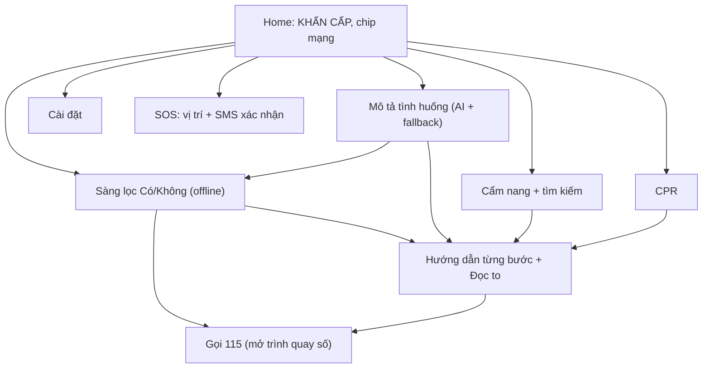

### 2.6 Ảnh giao diện (emulator Android 13, bản debug; không phải điện thoại thật)
| Home Sáng (2026-11-06)* | Home Tối (2026-11-06)* | Sàng lọc (2026-11-07) | Hướng dẫn CPR (2026-11-07) |
|---|---|---|---|
| 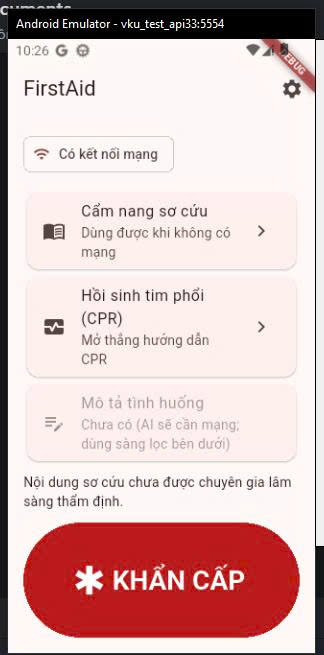 | 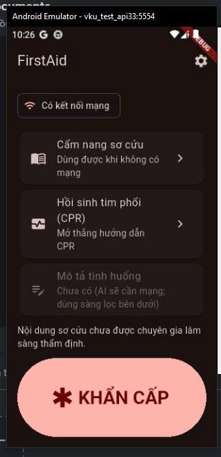 | 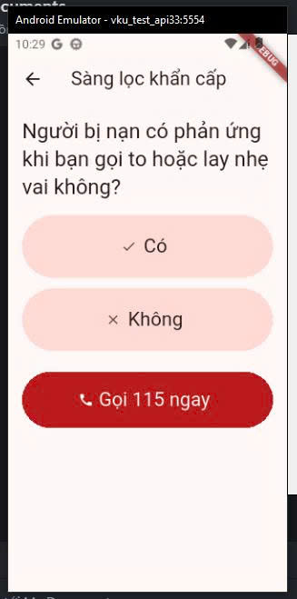 | 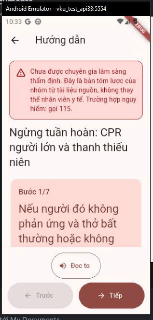 |

\* Hai ảnh Home chụp trước khi có tính năng AI nên thẻ "Mô tả tình huống" còn bị tắt. Ảnh "Sàng lọc" có tên file chứa "dark" nhưng hiển thị giao diện **Sáng**. Ảnh bản release hiện tại ở mục 5.3.

| Cẩm nang (2026-11-07) | Gọi 115 mở trình quay số (2026-11-07) | Kết quả sàng lọc hóc dị vật em bé (2026-11-07) |
|---|---|---|
| 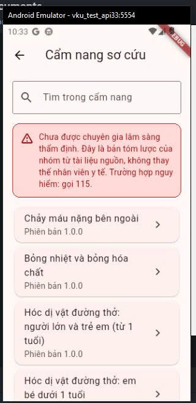 | 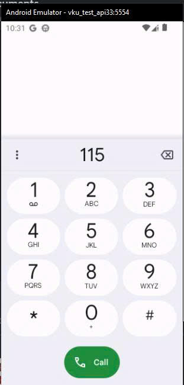 | 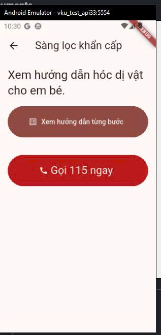 |

Ảnh chụp Sáng/Tối trên điện thoại thật cho từng màn: [CHỜ NGƯỜI DÙNG CHỤP] (`docs/evidence/screenshots/emergency_ui.md`).

---

## CHAPTER 3: SYSTEM DESIGN & CLEAN ARCHITECTURE

### 3.1 Kiến trúc tổng thể
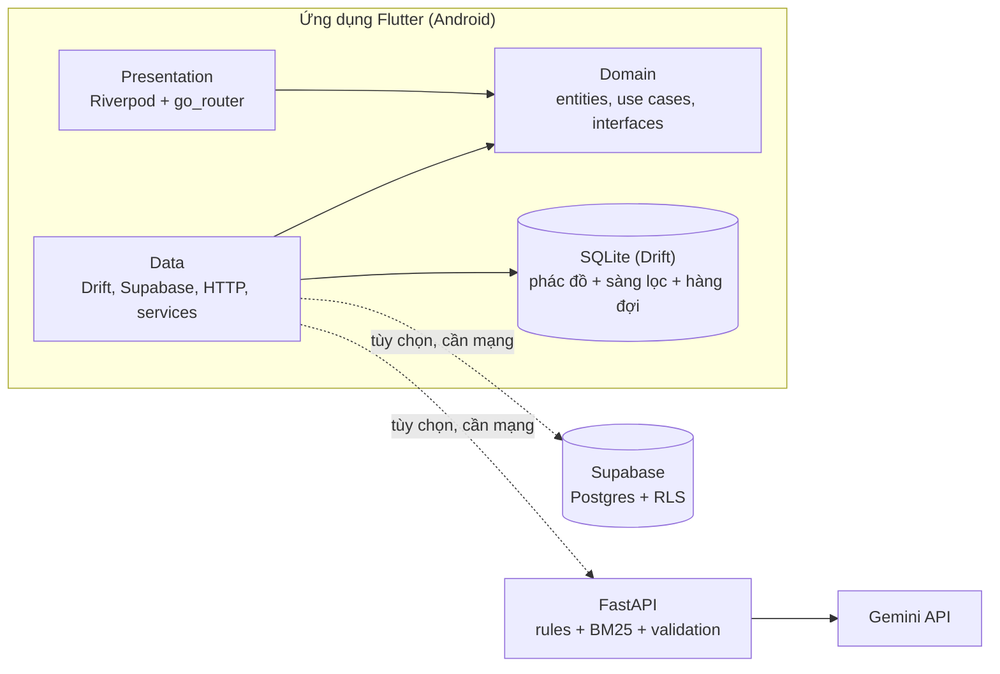
Luồng sơ cứu cốt lõi chỉ dùng phần trong khung "Ứng dụng Flutter". Supabase và FastAPI/Gemini là lớp tùy chọn: khi lỗi hoặc không có mạng, app dùng dữ liệu và cây sàng lọc cục bộ.

### 3.2 Clean Architecture ba lớp
- **Domain** (`app/lib/domain/`): Dart thuần (entities, interface repository/service, use case). Không import Flutter, Drift, Supabase, http, Riverpod; được kiểm bằng `app/test/architecture/domain_isolation_test.dart` (E-005). Quy tắc phụ thuộc: Presentation → Domain ← Data; `core/di` là composition root.
- **Data** (`app/lib/data/`): hiện thực interface của Domain bằng Drift, Supabase, `http`, flutter_tts, geolocator, url_launcher, connectivity_plus, shared_preferences.
- **Presentation** (`app/lib/presentation/`): 7 màn, widget dùng chung, theme, router; chỉ gọi use case qua provider.
- Nhờ interface ở Domain, use case và màn hình được kiểm thử bằng fake (R3 mục 3.1).
- Quy mô: 4629 dòng Dart trong `app/lib` (không tính `*.g.dart`), 17 file Dart trong `app/test` và `app/integration_test` (lệnh `find app/test app/integration_test -name "*.dart" | wc -l`).

### 3.3 Dữ liệu cục bộ (Drift/SQLite)
Schema version 2 (`app_database.dart`): bảng `protocols`, `protocol_steps`, `triage_nodes`, `meta`, `sync_jobs`. Seed từ `assets/protocols/protocols_v1.json` (6 phác đồ) và `assets/triage/triage_v1.json` (cây quyết định tĩnh, không phải AI) ở lần chạy đầu và khi `data_version` đổi. Migration v1 → v2 thêm `sync_jobs` (D-029). Dữ liệu y tế chỉ đọc với UI.

### 3.4 Supabase, RLS và chính sách đồng bộ
Nguồn: `supabase/migrations/0001_init.sql`; chi tiết ERD và bảng RLS ở R2 mục 2.
- Ba bảng, RLS bật ở cả ba: `protocols_remote` (anon và authenticated chỉ đọc), `sos_logs` (append-only, chỉ người sở hữu, bắt buộc `consent = true`), `sync_events`.
- **Đã kiểm chứng:** kịch bản `supabase/tests/rls_test.sql` do nhóm chạy trên Supabase cho **13/13 PASS** (E-015, `docs/evidence/rls/rls-test-20261107-001222.csv`). Giới hạn: chỉ 13 ca trong script, chưa phủ `sync_events`, chưa có ảnh SQL Editor; chưa thử `SupabaseRemoteSyncSource` từ app với server thật.
- **Chính sách xung đột** (R3 mục 2): server thắng nhưng chỉ nhận bản `reviewed` + `verified` và version mới hơn; ghi trong một transaction; seed không ghi đè bản mới từ server; log SOS append-only với UUID do client sinh (idempotent); hàng đợi retry tối đa 5 lần, backoff mũ 30 s đến 1 giờ (giá trị do nhóm chọn, chưa đo).

### 3.5 Backend định tuyến AI
`backend/app/`: `main.py` (FastAPI: `GET /healthz`, `POST /v1/route-situation`, SSE khi `?stream=true`), `rules.py` (quy tắc 115 xác định), `retrieval.py` (BM25 trên chỉ mục `verified`), `llm.py` (Gemini, timeout, retry giới hạn), `router_service.py`, `schemas.py` (JSON cố định 5 trường), `textnorm.py`. Chi tiết và số đo ở Chương 4. Backend **đã deploy** trên Render ngày 2026-11-12 tại https://firstaid-capstone.onrender.com (theo người dùng: Docker, gói Free, vùng Singapore). Bằng chứng: `healthz: status=ok` và một lần gọi `route-situation` trả `burns_thermal_chemical` (`docs/evidence/ai/render-deploy-check-20261112-111702.txt`), ảnh log Render "Your service is live" (`docs/evidence/ai/render-service-live-20261112.png`); E-042. Đây là một lần gọi thủ công, không phải số đo. Rủi ro: gói Free ngủ khi không dùng nên lần gọi đầu chậm; endpoint công khai không xác thực (theo người dùng) và chưa có rate limit (R-21); `GEMINI_API_KEY` chỉ ở biến môi trường của Render, không có trong app hay workflow.

### 3.6 Bảo mật và quyền riêng tư
- Không hardcode secret; cấu hình qua `--dart-define(-from-file)`; `.env`, `*.jks`, `key.properties` gitignore. Repo public.
- Quyền Android: chỉ `ACCESS_FINE_LOCATION`, `ACCESS_COARSE_LOCATION`, `INTERNET`, `ACCESS_NETWORK_STATE`; không `SEND_SMS`, không background location (D-020).
- HTTP không mã hóa chỉ ở bản debug (D-048); release phải dùng https.
- Mô tả tình huống gửi tới Gemini (bên thứ ba) chỉ sau khi người dùng đồng ý; backend không ghi log nội dung (R-22).
- Token `X-API-Key` nhúng trong app **không phải bí mật** (R-21, D-040). Bản deploy trên Render hiện không bật xác thực (theo người dùng) và chưa có rate limit, nên ai biết URL cũng gọi được và có thể làm cạn quota Gemini (R-21).
- `GEMINI_API_KEY` chỉ đặt trong biến môi trường của Render (theo người dùng); không có trong app, repo hay workflow.

### 3.7 Cấu hình build và hệ quả
`AppConfig` đọc `SUPABASE_URL`, `SUPABASE_ANON_KEY`, `AI_BASE_URL`, `AI_API_KEY`, `AI_TIMEOUT_SECONDS` bằng `String.fromEnvironment` (giá trị cố định lúc compile). Thiếu cấu hình thì AI và Supabase tự tắt, app vẫn chạy offline. Workflow release hiện **không truyền** các giá trị này nên bản v0.1.0 là offline-only (R-33).

---

## CHAPTER 4: ADVANCED CAPABILITIES & ARTIFICIAL INTELLIGENCE
**Thiết kế.** Tính năng AI là một dịch vụ FastAPI định tuyến mô tả tình huống tới mã phác đồ có sẵn. Dịch vụ không tạo nội dung sơ cứu: LLM (Gemini) chỉ chọn một mã trong danh sách ứng viên do truy xuất BM25 trên các phác đồ `verified`, hoặc trả `null` khi mơ hồ/ngoài phạm vi. Kết quả luôn là JSON cố định 5 trường, được validate (schema, allowlist, ứng viên, chủ đề, nguồn) trước khi dùng; sai thì trả mã lỗi để app quay về sàng lọc cục bộ.

**Vì sao RAG-lite (BM25) mà không dùng embedding.** Chỉ 6 phác đồ, chạy thuần Python, không cần mô hình/hạ tầng thêm, kết quả giải thích được và kiểm thử xác định. Đổi lại truy xuất chỉ dựa từ khóa và nhạy cách diễn đạt (đo được top-1 9/14 trên bộ ca tự gán nhãn).

**Vì sao AI chỉ trả mã.** Nội dung sơ cứu phải có trích dẫn nguồn và không được sinh từ kiến thức của model (CLAUDE.md §6). Chọn mã thu hẹp bề mặt rủi ro: sai mã vẫn dẫn tới phác đồ có nguồn, và người dùng luôn thấy cảnh báo chưa thẩm định cùng nút Gọi 115.

**An toàn.** Quy tắc xác định (không qua LLM) kích hoạt "gọi 115" cho dấu hiệu nguy cấp (không thở/không phản ứng, hóc không ho/nói được, chảy máu phun/không cầm được). Quy tắc không đoán tuổi. Mô tả nội dung người dùng không bị ghi log.

**Streaming.** SSE gồm `status`, `delta` (mảnh tạm chưa validate, chỉ hiển thị tiến trình) và `result` đã validate. Chưa đo time-to-first-token.

**Đo lường.** Xem R3 mục 1. Đã đo offline quy tắc, truy xuất và mô phỏng lỗi, và đã chạy eval với Gemini thật (gemini-2.5-flash) 2 lượt trên 35 ca. Kết quả lần 2 (sau khi sửa định dạng nguồn trong prompt): nguồn hợp lệ 5/5 (100%), đúng mã 18/20 (90%) trên các ca có trả lời, độ trễ đường LLM p50 2698 ms và p95 3244 ms (n=6), lỗi hạ tầng 14/35 (40%), toàn bộ là HTTP 429 (rate limit; lần 1 là 9/35 = 25,7%, nguồn hợp lệ 0/3).

*Cách đọc các số này.* Đây là mẫu rất nhỏ: do 429, chỉ 6 ca lần 2 đi tới đầu ra LLM, và 14 ca chưa có kết quả LLM. Các tỷ lệ vì vậy không ổn định, hai lượt không so sánh trực tiếp được (tập ca trả lời khác nhau), và 100% nguồn hợp lệ chỉ dựa trên 5 ca. Nhãn do nhóm tự gán, cần rà lại; số đo mô tả hành vi trên tập nhỏ này, không phải độ chính xác tổng quát. Hai lượt eval chạy với cấu hình retry hiện tại (tối đa 2 lần gọi, backoff 0,5 s), chưa chạy với retry/backoff đủ dài để vượt giới hạn tốc độ. Time to first token của SSE chưa đo; eval dùng chế độ không stream. Chi tiết và đường dẫn bằng chứng: R3, evidence-ledger E-020 (`docs/evidence/ai/eval-llm-20261108-020235.json`, `docs/evidence/ai/eval-llm-20261108-021429.json`).

**Tích hợp vào app và fallback (Prompt 07).** Màn "Mô tả tình huống" gửi mô tả tới `/v1/route-situation` qua SSE và chỉ dùng sự kiện `result` đã validate. Kết quả là mở phác đồ từ CSDL cục bộ (Drift) theo `protocol_code`, kèm nguồn, phiên bản, cảnh báo chưa thẩm định và nhãn "KẾT QUẢ THAM KHẢO"; app không hiển thị văn bản do LLM sinh (kể cả `confidence_note`). Mọi đường hỏng đều quay về cây quyết định tĩnh chạy offline: mất mạng, không tới được máy chủ, timeout (deadline tổng 15 s do nhóm chọn, chưa đo trên mạng thật), lỗi máy chủ (gồm 429), sai schema, `uncertain`, mã không có trong Drift hoặc chủ đề không khớp. Từ khóa nguy cấp được kiểm tra ngay trên máy trước khi gửi (bản port 1-1 của quy tắc backend, khớp 35/35 ca eval khi so chéo) và dẫn thẳng tới "Gọi 115". Nút "Bỏ qua AI, sàng lọc ngay" và "Gọi 115" luôn hiện, bấm bỏ qua sẽ hủy yêu cầu HTTP ngay. Khi AI đã được cấu hình, trước lần gửi đầu app thông báo văn bản sẽ được gửi tới máy chủ và Gemini (bên thứ ba) và xin đồng ý; có thể đổi trong Cài đặt. Khi chưa cấu hình `AI_BASE_URL` (như bản release v0.1.0, R-33), app hiện ngay thẻ "Ứng dụng chưa được cấu hình máy chủ AI" kèm nút sàng lọc offline, không hỏi đồng ý và không hiện thông báo gửi dữ liệu vì không có gì được gửi (D-061); từ khóa 115 vẫn được kiểm tra trên máy.

*Kiểm chứng.* 119 test tự động pass tại thời điểm tích hợp (nay bộ test là 159 test pass sau bản sửa R-33), gồm unit test use case với fake repository (thành công, uncertain, timeout, mã sai, call_115_now, mất mạng, không đồng ý...), test client SSE bằng `MockClient` và widget test từng trạng thái màn hình (`docs/evidence/tests/ai-integration-checks-20261110-002444.log`); build APK debug thành công (`docs/evidence/tests/build-apk-debug-20261110-002726.log`). Đã chạy thủ công app (debug) trên emulator với backend local thật vài lần (2026-11-10, E-031; ảnh bên dưới và R3 mục 1b); chưa chạy trên điện thoại thật. Video kịch bản online → AI → tắt mạng → fallback: [CHỜ NGƯỜI DÙNG QUAY VIDEO].

| Kết quả AI → phác đồ (bỏng) | Từ khóa nguy cấp → GỌI 115 (không gửi đi) | Fallback khi tắt mạng (biểu tượng máy bay) |
|---|---|---|
| 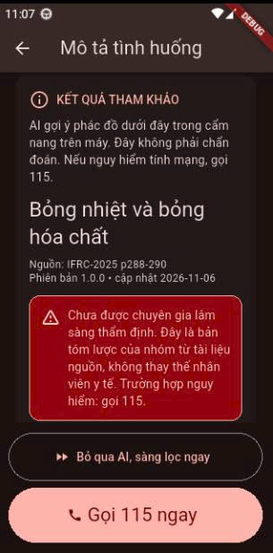 | 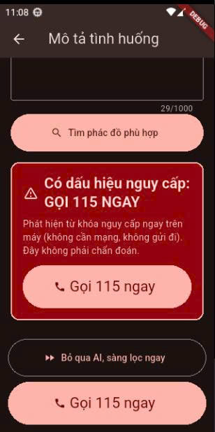 | 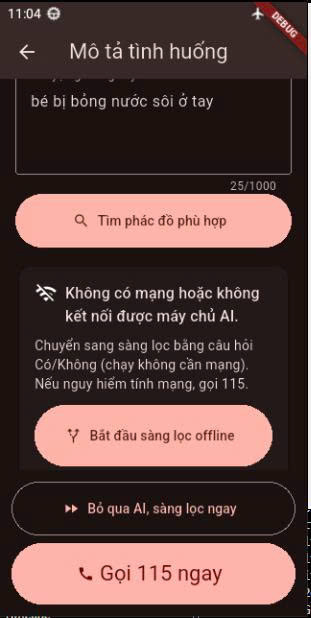 |

Ảnh chụp trên emulator, bản debug, 2026-11-10. Log backend chỉ có 1 dòng nên không chứng minh ảnh "bỏng" ứng với đúng dòng log đó (R3 mục 1b).

**Hạn chế.** Phủ 4 chủ đề; backend đã deploy trên Render gói Free (E-042) nhưng mới gọi thử thủ công một lần, chưa có số đo nào từ bản deploy; app đã tích hợp và chạy thủ công vài lần trên emulator với backend local thật (E-031), nhưng chưa chạy trên điện thoại thật và chưa với backend đã deploy; danh sách từ khóa 115 tồn tại ở hai nơi (Dart và Python) nên phải sửa đồng thời; kiểm thử với Gemini thật mới ở mẫu nhỏ và bị rate limit (40% ca không có kết quả LLM); chưa thử retry/backoff dài; chưa đo SSE với Gemini thật; từ khóa quy tắc chưa rà soát lâm sàng; nội dung tình huống gửi tới bên thứ ba khi dùng đường LLM.

---

## CHAPTER 5: TESTING, PERFORMANCE PROFILING & EVALUATION

### 5.1 Kiểm thử, accessibility và Dark Mode
**Chiến lược kiểm thử.** Nhờ Clean Architecture, mọi phụ thuộc nền tảng (mạng, TTS, trình quay số, vị trí, SMS, AI) đi qua interface ở Domain, nên use case và màn hình được kiểm thử với fake. Có bốn tầng: unit test Domain; test Data trên SQLite in-memory và HTTP giả lập (`MockClient`); widget test từng màn và từng trạng thái (gồm mọi nhánh fallback của AI); integration test chạy trên thiết bị.

**Kết quả.** 155 test tự động pass khi đo coverage, `flutter analyze` không có vấn đề (`docs/evidence/tests/quality-checks-20261110-013916.log`); sau bản sửa R-33 bộ test là 159 pass (`docs/evidence/tests/r33-hide-privacy-notice-checks-20261111-233445.log`) và coverage chưa đo lại. Coverage dòng thật từ lcov: 1495/1716 (87.12%) nếu không tính file sinh tự động, 2010/3429 (58.62%) nếu tính cả `app_database.g.dart`. Lớp domain 272/280, presentation 685/708. Phần phủ thấp chủ yếu là wrapper nền tảng chỉ chạy được trên thiết bị và nguồn Supabase (chi tiết R3 mục 3.2). Integration test luồng khẩn cấp ở chế độ máy bay pass trên emulator Android 13 (`docs/evidence/tests/integration-emergency-offline-20261110-012638.log`); chưa chạy trên điện thoại thật.

**Accessibility và Dark Mode.** Bảy màn chính được kiểm tự động ở cả giao diện Sáng và Tối với ba guideline của Flutter (vùng chạm ≥ 48 dp, nút có nhãn, tương phản chữ) và ở cỡ chữ 200%. Có test đối chứng để chứng minh các kiểm tra không "rỗng". Quá trình này tìm ra ba lỗi thật và đã sửa: chữ bị cắt trong nút cao cố định khi phóng to chữ, app bỏ qua cỡ chữ hệ thống, và thẻ kết quả AI nằm ngoài vùng nhìn thấy trên màn nhỏ (R3 mục 3.4). Dark Mode chưa được xem trên điện thoại thật; có một ảnh Dark Mode trên emulator (màn Home, 2026-11-06, xem mục 2.6).

### 5.2 Hiệu năng
**Hiệu năng.** Đã sửa các điểm nghi ngờ gây jank: dựng lại theme mỗi lần build, ghi đĩa mỗi frame khi kéo thanh cỡ chữ, danh sách nháy khi tìm kiếm (R3 mục 3.5). Chưa có số đo trước/sau. **FPS và frame time: [CHỜ SỐ ĐO THẬT]**. Quy trình đo profile mode trên máy thật và perf test lặp lại được đã chuẩn bị (`docs/evidence/fps/README.md`, `docs/evidence/fps/fps-measurements.md`).

**Đánh giá AI.** Xem Chapter 4 và R3 mục 1.

**Hạn chế.** Chưa đo FPS; chưa chạy trên điện thoại thật; coverage là coverage dòng (không phải nhánh) và không gồm integration test; test widget dùng font Ahem nên kiểm tra cỡ chữ mang tính bảo thủ; tương phản mới đo trong môi trường test.

### 5.3 CI/CD & ký số release (tiêu chuẩn 5)
**Thiết kế.** Có hai workflow GitHub Actions, đều chạy trên `ubuntu-latest`:
- `.github/workflows/ci.yml` chạy với mọi push và PR, gồm hai job:
  - Flutter: `dart format --set-exit-if-changed`, `flutter analyze`, `flutter test`.
  - Backend: `pytest` với Python 3.10.
  - Workflow này không dùng secret.
- `.github/workflows/release.yml` chạy khi push tag `vX.Y.Z` hoặc chạy tay:
  1. Chạy lại analyze và test.
  2. Giải mã keystore từ secret `KEYSTORE_BASE64` vào thư mục tạm của runner và tạo `app/android/key.properties` từ `KEYSTORE_PASSWORD`, `KEY_ALIAS`, `KEY_PASSWORD`.
  3. Gọi Fastlane lane `android release` (`app/android/fastlane/Fastfile`), lane này:
     - Build AAB và APK release. Tên phiên bản lấy từ tag; versionCode là số lần chạy workflow.
     - Xác minh chữ ký: apksigner cho APK, jarsigner/keytool cho AAB.
     - Từ chối nếu thiếu `key.properties` hoặc nếu chứng chỉ là `CN=Android Debug`.
     - Ghi SHA-256 của từng file.
  4. Xóa keystore ở bước `if: always()`, rồi upload artifact.
- Gradle (`app/android/app/build.gradle.kts`) đọc khóa ký từ `key.properties`. File này gitignore. Thiếu file thì bản release ký bằng khóa debug, chỉ để chạy thử trên máy. Đã kiểm tra: apksigner báo `CN=Android Debug`, đúng chuỗi mà Fastlane lane dùng để từ chối.

**Bảo mật (repo public).**
- Keystore, mật khẩu và `key.properties` không nằm trong repo; `.gitignore` chặn `*.jks`, `*.keystore`, `key.properties`.
- Secret chỉ đi qua biến môi trường của một bước. Workflow không echo secret, và GitHub che giá trị secret trong log.
- PR từ fork không đọc được secret.
- Hướng dẫn tạo và sao lưu keystore, thêm Secrets: `docs/evidence/ci/release-signing-guide.md`.

**Phiên bản công cụ.** CI cấu hình Flutter 3.47.6 stable và JDK Temurin 21, khớp máy phát triển; Python 3.10. Bản vá JDK, Python và build-tools trên runner có thể khác máy dev; bảng so sánh ở `docs/evidence/ci/ci-runs.md`. Fastlane `~> 2.225` chạy trên Ruby 3.3; chưa có Gemfile.lock.

**Kết quả chạy thật trên GitHub (ci: 2026-11-11; release: 2026-11-12).**
- **ci #1** (commit 40f917a): Success, 2m 14s (theo ảnh; ledger E-037).
- **release #1** (tag v0.1.0, commit c0fcdec): Success, 7m 55s, 1 artifact (ảnh + link run; ledger E-038). Đây là lần đầu **Fastfile chạy thật** (trước đó chưa chạy được vì máy dev không có Ruby). Các giá trị dưới đây lấy từ `docs/evidence/ci/release-run-v0.1.0-20261112/`:
  - APK: `apksigner` báo v2 scheme verified; AAB: `jarsigner` báo "jar verified.".
  - Chủ sở hữu chứng chỉ: CN=FirstAid Team, OU=Khoa Khoa hoc May tinh, O=VKU, Da Nang, VN. Chứng chỉ tự ký, hiệu lực đến 2054-03-30; chữ ký không có timestamp; jarsigner cảnh báo chuỗi chứng chỉ không xác minh được qua CA (đúng với chứng chỉ tự ký). File `jarsigner-verify-summary.txt` là bản rút gọn của đầu ra jarsigner.
  - SHA-256 chứng chỉ: `958b380653a70f42c50609ae1a844a6551096ec170b654bc1ff66f0d9869b3a8` (apksigner và keytool của AAB cho cùng giá trị).
  - SHA-256 APK `83eed80bb05584a79203eb5c608c943c2170fe5e5ad5719d3d7165b6741c0081`, AAB `fbf54243fe84d4cc9bb4b8354fd0e57898ebce259a3b1338bceb93c71fb6c220`, khớp `SHA256SUMS.txt`.
- **Cài thử:** APK từ workflow cài lên emulator `vku_test_api33` ngày 2026-11-12 (`adb install` báo Success theo người dùng; `dumpsys`: versionName 0.1.0, versionCode 1, minSdk 24, targetSdk 36) và chạy được Home, Cẩm nang, Mô tả tình huống (ảnh trong `docs/evidence/screenshots/release-v0.1.0-*.png`; E-039).
- **Bản này là offline-only (R-33):** release.yml không truyền `--dart-define`, nên bản build không có AI và không có Supabase. Màn "Mô tả tình huống" hiện thẻ "Ứng dụng chưa được cấu hình máy chủ AI.", không hỏi đồng ý gửi dữ liệu.

| ci #1 (GitHub Actions) | release #1, tag v0.1.0 (GitHub Actions) |
|---|---|
| 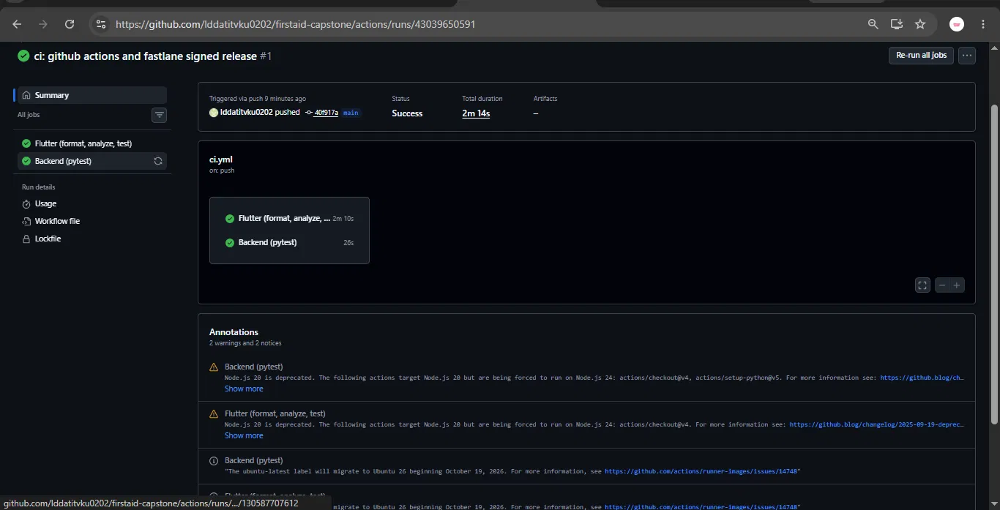 | 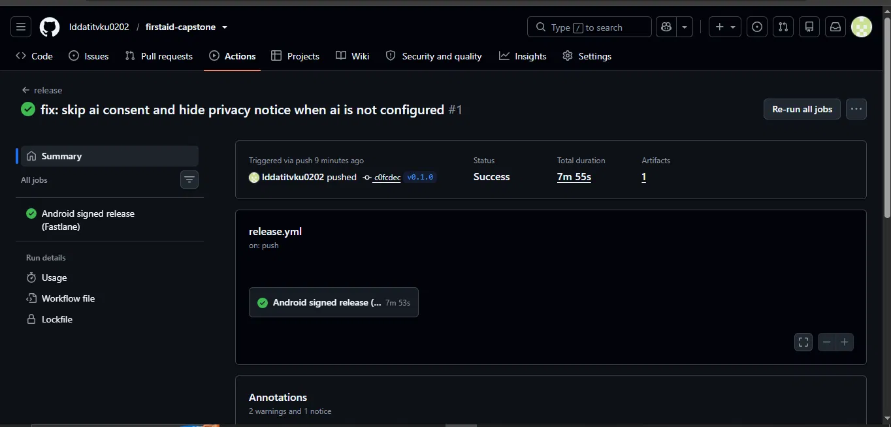 |

(Ảnh release #1 có tên file ghi 20261111 nhưng run chạy ngày 2026-11-12.)

| Home (release) | Cẩm nang (release) | Mô tả tình huống: chưa cấu hình AI (release) |
|---|---|---|
| 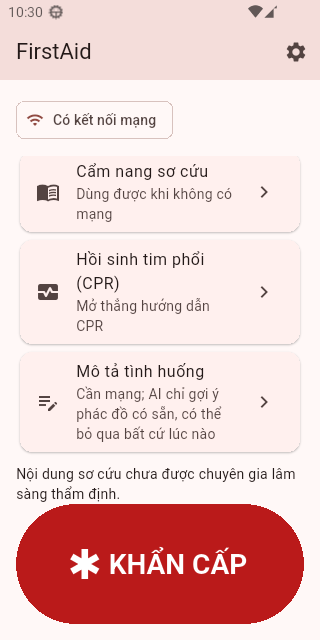 | 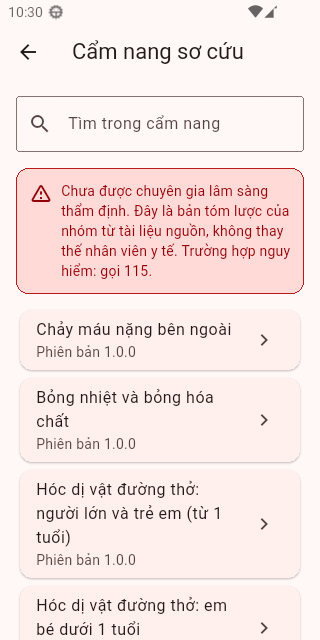 | 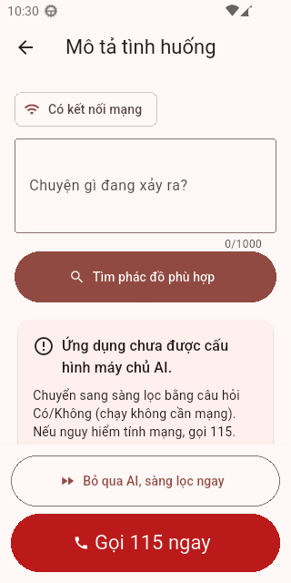 |

Ba ảnh trên chụp từ APK v0.1.0 cài lên emulator `vku_test_api33` (2026-11-12, giao diện Sáng, không có băng DEBUG). Ảnh không tự chứng minh nguồn APK; điều đó dựa vào `installed-package-info.txt` và lời người dùng (E-039).

**Kiểm chứng trước đó (cục bộ, Windows).**
- Đã build AAB và APK release bằng một keystore **thử dùng một lần**, không phải keystore thật (`docs/evidence/ci/local-signing-check-20261111-194317.log`):
  - APK: `apksigner verify` báo "Verified using v2 scheme: true", chứng chỉ `CN=FirstAid Throwaway Test, O=VKU, C=VN`.
  - AAB: `jarsigner -verify` báo "jar verified.", kèm cảnh báo bình thường cho chứng chỉ tự ký và không có timestamp.
- Điều này cho thấy cấu hình ký trong Gradle hoạt động.
- Lệnh của job Flutter trong CI chạy cục bộ (`docs/evidence/ci/local-ci-flutter-20261111-195857.log`): format 0 changed (93 file), analyze "No issues found!", 155 test pass.
- Backend pytest cục bộ: 60 passed (`docs/evidence/ci/local-ci-backend-20261111-194606.log`).
- Hai file workflow parse YAML hợp lệ.

**Chưa kiểm chứng / còn thiếu.**
- Log từng bước của release workflow chưa tải về (chỉ có ảnh tổng quan, link run và các file kết quả); `jarsigner` chỉ lưu bản rút gọn.
- Chưa cài và chạy trên điện thoại thật (mới có emulator); chưa đo FPS.
- Bản release chưa có cấu hình AI/Supabase (R-33); chưa kiểm tra luồng AI hay đồng bộ trong bản release.
- Chứng chỉ tự ký, chưa có kênh phân phối như Play Store (upload key/App Signing chưa làm).
- Chi tiết các lần chạy: `docs/evidence/ci/ci-runs.md`.

---

## CHAPTER 6: CONCLUSION, LESSONS LEARNED & FUTURE WORK

### 6.1 Kết quả so với mục tiêu
| Tiêu chuẩn | Trạng thái | Tóm tắt (chi tiết ở Phụ lục A và các chương trước) |
|---|---|---|
| 1. Clean Architecture 3 lớp | Đạt ở mức kiến trúc và test tự động (chưa thử trên máy thật) | Domain Dart thuần, có test cô lập (E-005); Data hiện thực bằng Drift/Supabase/http/service nền tảng; 159 test pass (R3 mục 3.1) |
| 2. AI thực sự (Streaming LLM) | Một phần | Backend FastAPI + Gemini + SSE + validation, app tích hợp và fallback an toàn; eval Gemini thật 2 lượt nhưng mẫu nhỏ, 40% ca bị HTTP 429; backend chưa deploy; bản release offline-only |
| 3. Offline-First (Drift + Supabase) | Một phần | Drift + seed + hàng đợi hoạt động trong test; RLS 13/13 PASS trên Supabase; app chưa thử với Supabase thật; chưa thử trên máy thật |
| 4. Material 3, Dark Mode, 60fps | Một phần | M3 sáng/tối, accessibility được kiểm tự động; **FPS: [CHỜ SỐ ĐO THẬT]**; Dark Mode mới có ảnh trên emulator |
| 5. Ký số release qua Fastlane CI/CD | Một phần (đã chạy thật) | ci #1 và release #1 (tag v0.1.0) chạy xanh; APK v2 verified, AAB jar verified; chứng chỉ tự ký; chưa có link tải ổn định, chưa thử trên máy thật |

### 6.2 Hạn chế hiện tại
- Chưa chạy trên điện thoại Android thật: không có video demo, không có số FPS, chưa kiểm chứng TTS vi-VN, GPS, SMS và Dark Mode trên máy thật (R-04, R-11, R-14, R-16).
- Nội dung sơ cứu là bản tóm lược của nhóm từ IFRC-2025, **chưa được chuyên gia lâm sàng thẩm định**; nguồn Việt Nam chưa đối chiếu (R-03, R-08, R-10); câu hỏi sàng lọc và từ khóa 115 do nhóm soạn (R-13, R-23).
- AI: chỉ 4 chủ đề; số đo LLM thật là mẫu rất nhỏ; chưa đo time to first token; backend đã deploy (Render, gói Free, E-042) nhưng chưa có số đo nào từ bản deploy, endpoint chưa có xác thực/rate limit (R-21) và lần gọi đầu chậm khi dịch vụ ngủ; chưa thử retry/backoff dài để vượt rate limit (R-27).
- Bản release v0.1.0 không có AI và Supabase (R-33). Chứng chỉ ký tự ký, chưa có kênh phân phối như Play Store.
- Log SOS chưa nối UI, chưa có đăng nhập/giao diện đồng ý (R-19). Danh sách từ khóa 115 tồn tại ở hai nơi (Dart và Python) phải sửa đồng thời (R-28).
- Coverage là coverage dòng; số 87,12% (không tính file sinh tự động) và 58,62% (tính cả) đo ở bản 155 test, chưa đo lại ở bản 159 test.

### 6.3 Bài học kinh nghiệm (rút từ sự kiện có trong repo)
1. **Lỗi giao diện "im lặng" cần test chủ động.** Ở cỡ chữ 200%, chữ bị cắt trong 14 nút cao cố định mà Flutter không báo lỗi; chỉ phát hiện nhờ test tự viết so chiều cao chữ với chiều cao được cấp (R3 mục 3.4). Test kiểm tra cần có test đối chứng để chứng minh nó thật sự bắt được lỗi.
2. **Chạy trên thiết bị tìm ra lỗi mà widget test bỏ sót.** Thẻ kết quả AI nằm ngoài vùng nhìn thấy trên màn nhỏ, lộ ra ở lần chạy integration test thứ ba trên emulator (D-054).
3. **Hủy yêu cầu mạng phải truyền xuống tầng thấp nhất.** Dùng `await for` không chuyển việc hủy subscription tới luồng mạng; code dùng `yield*` (chú thích trong `route_situation.dart`) và có test xác nhận hủy.
4. **LLM không đáng tin để là đường chính.** 14/35 ca (40%) của eval lần 2 gặp HTTP 429; vì vậy fallback cục bộ là đường chính phải thiết kế trước, không phải ngoại lệ. Nên lưu đầu ra thô của LLM ngay từ lần đầu: lần 1 không lưu nên không xác nhận được nguyên nhân lỗi nguồn (0/3 → 5/5 sau sửa prompt, mẫu nhỏ).
5. **Cấu hình lúc build phải được quyết định sớm.** Workflow release không truyền `--dart-define`, nên bản v0.1.0 offline-only; chỉ phát hiện khi rà code sau khi CI chạy (R-33). Nên đưa bước cấu hình vào thiết kế CI từ đầu.
6. **Kiểm tra tên file và nội dung bằng chứng.** Hai bằng chứng có tên không khớp nội dung: `triage-01-consciousness-dark.png` hiển thị giao diện Sáng; `release-run-1-success-20261111.png` là run ngày 2026-11-12.
7. **Chốt phạm vi sớm.** Hai tính năng đề xuất (bộ đếm nhịp CPR, bản đồ/cộng đồng) không kịp triển khai; việc ghi rõ "chưa làm" ở mọi báo cáo tránh tuyên bố vượt bằng chứng.

### 6.4 Hướng phát triển (Future Work, chưa triển khai, không cam kết)
- **P2 theo đề xuất:** vision triage (nhận diện từ ảnh), bản đồ điểm hỗ trợ và cộng đồng tình nguyện viên, cảm biến hỗ trợ CPR; bộ đếm nhịp CPR (Should-Have chưa làm).
- **Hoàn thiện nền tảng:** thêm xác thực và rate limit cho backend đã deploy, retry/backoff dài, đo độ trễ (kể cả lần gọi đầu khi dịch vụ ngủ), build release có cấu hình AI/Supabase từ GitHub Secrets/Variables; đo FPS profile mode và quay video trên điện thoại thật; thử app với Supabase thật, thêm ca `sync_events` vào kịch bản RLS; màn đăng nhập và giao diện đồng ý cho log SOS.
- **Chất lượng nội dung:** nhờ chuyên gia y tế rà soát phác đồ và cây sàng lọc; đối chiếu nguồn Việt Nam; mở rộng ngoài 4 chủ đề; mở rộng bộ ca eval và rà soát nhãn.
- **Phát hành:** link tải ổn định (GitHub Release/Drive), upload key hoặc Play App Signing nếu lên Play Store; commit Gemfile.lock; test tự động liên dự án cho danh sách từ khóa 115 (R-28).

---

## APPENDIX A: Trạng thái 5 tiêu chuẩn bắt buộc (đối chiếu `docs/requirements-traceability.md`)
| # | Tiêu chuẩn | Trạng thái | Bằng chứng chính |
|---|---|---|---|
| 1 | Clean Architecture 3 lớp | Done (kiến trúc + test tự động) | E-004, E-005, E-009, E-011, E-014, E-022 |
| 2 | AI thực sự (Streaming LLM) | Partial | E-017..E-022, E-031 |
| 3 | Offline-First (Drift + Supabase) | Partial | E-006, E-014, E-015, E-028 |
| 4 | Material 3, Dark Mode, 60fps | Partial | E-027, E-028, E-029; FPS E-030 [CHỜ SỐ ĐO THẬT] |
| 5 | Ký số release qua Fastlane | Partial | E-032..E-039 |

## APPENDIX B: Rủi ro chính (`docs/risk-register.md`, 33 mục)
| ID | Rủi ro | Mức | Trạng thái |
|---|---|---|---|
| R-03 / R-08 | Nội dung chưa được chuyên gia thẩm định | Cao | Mở (luôn hiện cảnh báo) |
| R-02 | Bản quyền tài liệu y khoa trên repo public | Cao | Mở (PDF bị `.gitignore` chặn) |
| R-13 / R-23 | Câu hỏi sàng lọc và từ khóa 115 chưa rà soát lâm sàng; rule bỏ sót 3/12 ca nguy cấp trong tập thử | Cao | Mở |
| R-27 | HTTP 429 làm 14/35 ca eval LLM không có kết quả | Cao | Mở |
| R-31 | Mất hoặc lộ keystore release | Cao | Mở |
| R-33 | Bản release không có cấu hình AI/Supabase | Trung bình | Mở (phần hỏi đồng ý đã sửa) |
| R-04 | Chưa có điện thoại Android thật (video, FPS) | Trung bình | Mở |

## APPENDIX C: Chỉ mục bằng chứng
- Sổ bằng chứng đầy đủ: `docs/evidence-ledger.md` (E-001 đến E-039); quyết định thiết kế: `docs/decision-log.md` (D-001 đến D-061); truy vết: `docs/requirements-traceability.md`.
- Log kiểm thử: `docs/evidence/tests/`; eval AI: `docs/evidence/ai/`; RLS: `docs/evidence/rls/`; CI và ký số: `docs/evidence/ci/` (gồm `release-run-v0.1.0-20261112/`); ảnh chụp: `docs/evidence/screenshots/`; hướng dẫn đo FPS: `docs/evidence/fps/`.
